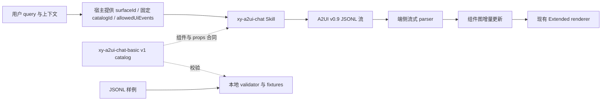

# XyAgenUI 对话式 A2UI Skill 与基础组件库方案

## 1. 背景与目标

端侧已经具备 A2UI 流式渲染能力。本项目维护面向对话回复的生成 Skill、组件目录和协议约束，使 Agent 能根据 query 内容选择合适的布局和基础组件，并通过流式 JSONL 持续呈现回答。

核心要求是：**每个用户 query 的答案都使用 A2UI 承载**。简单回答也由布局根节点和 `Extended.Text` 组成，不保留裸文本答案路径；复杂回答按需组织段落、比较、图片和可执行操作。

本阶段目标：

- 建立专用于对话回答的 A2UI profile。
- 建立 `xy-a2ui-chat-basic` v1 组件合同，约束可用组件和 props。
- 建立生成 Skill，指导内容保真、布局选择、流式更新和事件白名单处理。
- 用代表性 query fixtures 和离线校验器验证本地合同，并将 parser/renderer 验证纳入目标端集成验收。

## 2. 范围与非目标

首版包含布局组件和基础展示组件，不引入表单输入、复杂导航、数据绑定、条件渲染或自定义交互协议。服务端错误、取消和传输状态继续沿用宿主消息生命周期，不作为 query 答案的纯文本例外。

本仓库维护生成规则与组件合同；端侧 renderer 继续使用现有实现。对话消息的协议 `catalogId` 固定为 `ohos.a2ui.extended.catalog.form`，每轮 `surfaceId` 仍由宿主提供。

该固定值只满足对话消息的 wire 合同，不会自动注册本项目组件。据现有客户端实现合同，parser 会丢弃 `catalogId` 并使用静态 Extended registry；若目标宿主按此字段路由，必须将该值映射到支持下文 Chat v1 组件的 Extended registry。仓库 validator 不验证端侧路由。

## 3. 总体架构



一次回答的职责边界：

1. 宿主向 Skill 提供本轮 `surfaceId` 和可选的 `allowedUiEvents`；Skill 在 `createSurface.catalogId` 中始终写入 `ohos.a2ui.extended.catalog.form`。
2. Skill 先组织准确答案，再按内容复杂度选择最小合适的组件树。
3. Skill 输出完整 JSONL 消息。宿主逐行发送；端侧收到完整 JSON 对象后解析并增量渲染。
4. 端侧 renderer 使用已部署 registry 渲染组件。目录声明是生成与验证的合同，不会自动注册客户端组件。

## 4. 协议 profile

### 4.1 协议参考

本项目使用的 A2UI 协议 Profile 与 Extended renderer 合同统一放在 [`references/a2ui/`](../references/a2ui/)。Chat profile 定义对话消息的增量更新与组件范围；v1 catalog 定义允许的组件和属性。wire `catalogId` 固定为 `ohos.a2ui.extended.catalog.form`。

实际合同见 [`references/a2ui/profile.md`](../references/a2ui/profile.md)。据现有端侧 parser 合同，parser 接受 `createSurface`、单组件 `updateComponents.component` 及批量 `updateComponents.components`；聊天流约定每条 update 只发送一个组件，便于流式处理。端侧实现源码不在本仓库，需在目标部署验证。

### 4.2 消息与增量更新

消息字段、root 语义、组件图引用、累计文本更新及静态 Text 正文的权威定义见 [`references/a2ui/profile.md`](../references/a2ui/profile.md)。本方案采用 v0.9 JSONL，每行一个完整 JSON 对象；回答先创建 surface，再逐条发送单组件增量更新。

### 4.3 catalogId

对话 profile 的协议 `catalogId` 固定为 `ohos.a2ui.extended.catalog.form`；宿主路由要求以 [Profile](../references/a2ui/profile.md) 中的集成约定为准。组件合同标识 `xy-a2ui-chat-basic` 与协议 `catalogId` 用途不同，不得互换；离线 validator 不验证宿主映射。

## 5. Skill 路由与内容策略

Skill 的路由策略固定为“始终生成 A2UI”，不在纯文本和 UI 输出之间做选择。它先完成事实准确、完整的自然语言答案，再决定组件结构：

- 简短答案：一段 `Extended.Text`。
- 长答案：按段落或主题拆分 Text；尽量保持内容连续、易读。
- 结构化摘要：使用 Column 分区，必要时用 Divider；标签和值适合并排时用 Row。
- 比较：空间足够时使用 Row；窄对话容器使用 Column 纵向排列，保留比较维度和结论。
- 图片：只使用用户提供或可信工具返回的真实资源，并用 Text 补充说明或图注。
- 分组容器：仅在确实有助于理解内容时使用 `Extended.Card`；普通回答默认使用简单布局根节点。
- Stack：仅用于真实重叠或图片标注等 overlay 场景。

在任何布局下，所有实质答案内容、限定条件和用户要求的细节都要保留在组件内容中。不得为视觉简洁删掉重要事实，也不得依赖会截断正文的样式。

## 6. `xy-a2ui-chat-basic` v1 组件目录

机器可读组件合同位于 [`catalogs/xy-a2ui-chat-basic/v1/catalog.json`](../catalogs/xy-a2ui-chat-basic/v1/catalog.json)。目录采用版本化路径；对已有版本的破坏性合同调整应发布新版本。

| 类别 | 组件 | 用途 |
| --- | --- | --- |
| 布局 | `Extended.Card` | 有明确分组需求时使用的容器 |
| 布局 | `Extended.Row` | 横向并排布局 |
| 布局 | `Extended.Column` | 纵向布局及默认回答根节点 |
| 布局 | `Extended.Stack` | 有明确层叠关系的 overlay 容器 |
| 基础 | `Extended.Text` | 所有回答正文、标签和图注的承载组件 |
| 基础 | `Extended.Image` | 显示可信图片资源 |
| 基础 | `Extended.Divider` | 分隔不同内容区块 |
| 基础 | `Extended.Button` | 触发本轮白名单 UI 事件 |

属性范围以端侧 renderer 的实际实现为依据，并使用保守子集。组件 props 在 A2UI 消息中按协议放置；样式写入 `styles`。目录中的 schema 用于离线校验，不取代运行时 registry 和 renderer。

## 7. 交互安全约束

宿主可在本轮上下文提供：

```json
{
  "allowedUiEvents": [
    {
      "name": "open_item",
      "description": "打开当前结果中的项目",
      "contextSchema": {
        "type": "object",
        "properties": { "itemId": { "type": "string" } },
        "required": ["itemId"],
        "additionalProperties": false
      }
    }
  ]
}
```

按钮只能使用列表中精确匹配的 `action.event.name`，并提供符合相应 `contextSchema` 的参数。v1 使用字面量 JSON context；不生成 `functionCall`，不创造事件名或 schema 外参数。没有匹配事件时不生成按钮。v1 不包含任何输入控件或其他状态可变组件。

本仓库 validator 支持并验证声明的 JSON Schema 子集，包含 type、const、enum、本地 `$ref`、allOf、oneOf、properties、required、additionalProperties、unevaluatedProperties、items，以及常见数值、字符串和数组边界。新增 v1 事件 schema 时应保持在该子集内。

## 8. 仓库交付物

- [`skills/xy-a2ui-chat/SKILL.md`](../skills/xy-a2ui-chat/SKILL.md)：每个 query 始终输出 A2UI 的生成 Skill。
- [`references/a2ui/`](../references/a2ui/)：对话协议 Profile、renderer 合同及参考索引。
- [`catalogs/xy-a2ui-chat-basic/v1/catalog.json`](../catalogs/xy-a2ui-chat-basic/v1/catalog.json)：组件、props 和事件字段目录。
- [`examples/`](../examples/)：短答、长答、结构化摘要、比较、图片、允许事件与无事件样例。
- [`tools/validate_a2ui_chat.py`](../tools/validate_a2ui_chat.py)：逐行解析并校验协议、组件树、catalog props 和事件白名单。
- [`tests/test_validate_a2ui_chat.py`](../tests/test_validate_a2ui_chat.py)：固定 query 集与负向约束测试。

## 9. 验收标准

1. 所有短文本和复杂回答都输出 A2UI JSONL；无裸文本答案分支。
2. 每行可独立解析为 v0.9 JSON 对象，surface ID 一致，root 只定义一次。
3. 组件类型和 props 均属于 v1 catalog；子节点引用最终完整、无环且从 root 可达。
4. 长文本流更新保留累计内容，最终树包含完整答案。
5. 有白名单事件时只允许匹配事件及符合 schema 的 context；无白名单时无操作按钮。
6. 固定 query fixtures 覆盖短答、长答、摘要、比较、图片、有事件和无事件。
7. 目标端集成验收确认 parser 能逐条处理 JSONL，并由正确的 Extended registry 渲染 Text、布局、图片与按钮；本仓库的离线 validator 不替代此项验收。

## 10. 实施状态与下一步

本方案对应的 Skill、对话 profile、v1 catalog、七类 fixtures、离线 validator 和单元测试已在本仓库落地，且本地单元测试通过。当前仓库不包含端侧 `JsonlStreamParser` 或 renderer registry 实现，因此这里的验证覆盖 JSONL 结构、组件目录、props、事件白名单和 fixture 内容，不代表端侧流式渲染已验收。

后续宿主集成需要：

- 将本 Skill 接入 Agent 的技能发现和回答生成配置。
- 由宿主提供每轮 `surfaceId`；协议 `catalogId` 固定使用 `ohos.a2ui.extended.catalog.form`，并在按 catalog 路由的客户端中映射到 Chat v1 Extended registry。
- 将 `allowedUiEvents` 与运行时事件目录连接，并在服务端/宿主重复校验事件和参数。
- 在目标端确认固定 `catalogId` 路由到包含八种 `Extended.*` 组件的 registry，并做设备上的流式布局与可访问性验收。
- 用固定 query 集持续评测内容完整性、渲染成功率、解析失败率、未知组件/属性率和事件拒绝情况。
