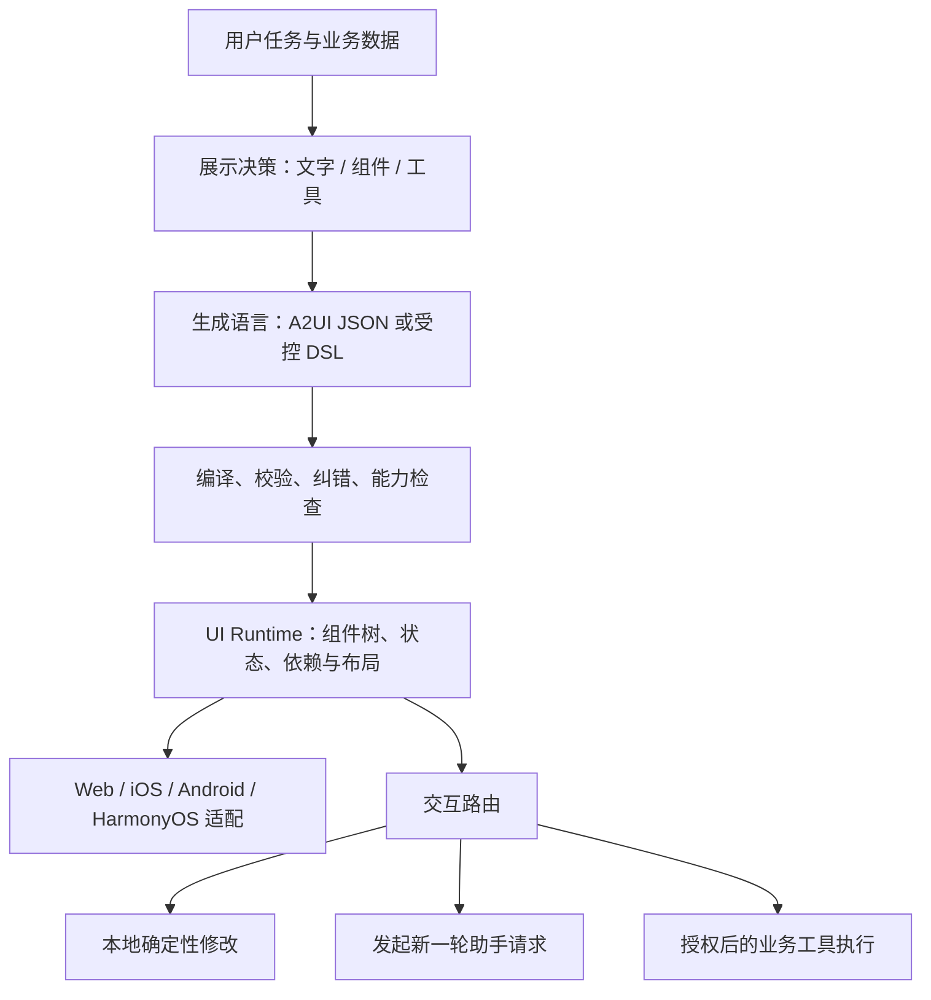
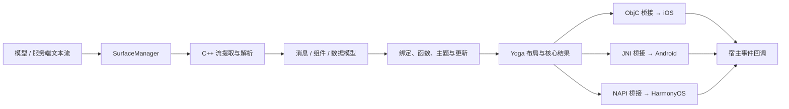
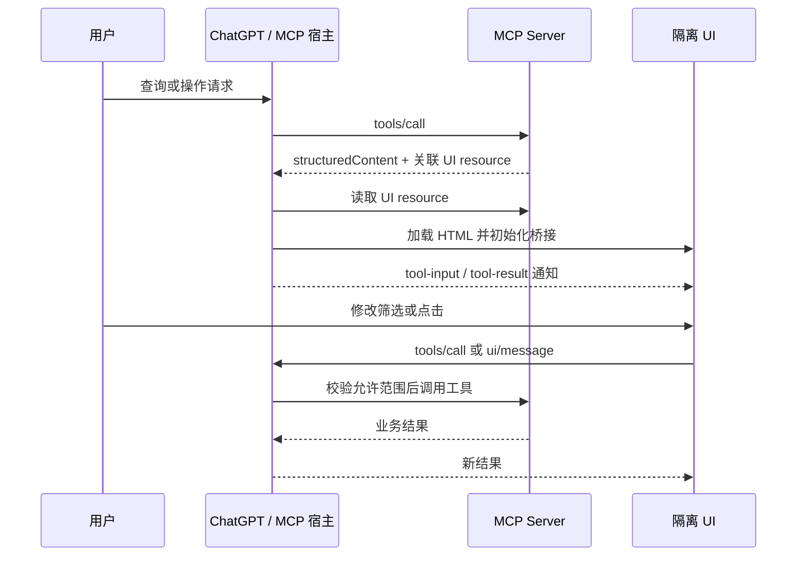
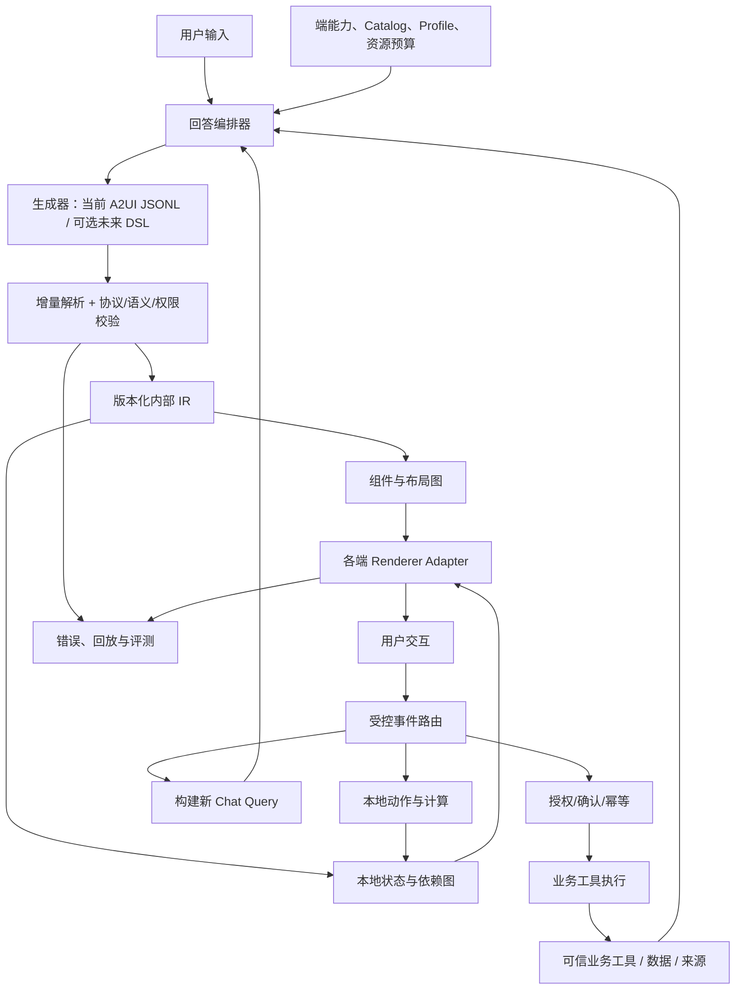

# 生成式交互 UI 竞品调研报告：高德 AGenUI、ChatGPT Intelligent UI 与 XyAgenUI

调研截点：2026-10-22。对象：高德 AGenUI、ChatGPT Intelligent UI；补充研究 A2UI、OpenAI Apps SDK / MCP Apps、Open Intelligent UI。用途：支撑 XyAgenUI 产品定义、技术选型、协议设计和验收。

> 本报告是历史竞品调研，不是当前协议或模型输出合同。当前实现以 `references/a2ui/official/`、`references/a2ui/profile.md` 和根目录 `SKILL.md` 为准；文中旧 `Extended.*` 与 `.form` 示例仅保留为当时的比较记录。

> **结论先行：建议以 ChatGPT 的“答案按需变成可操作工具”为体验目标，以 A2UI / AGenUI 的“受控组件、流式协议、原生渲染”为工程参考，并以独立的状态和权限系统连接二者。** 添加更多卡片组件只能扩大展示能力；要接近 Intelligent UI，还需要本地响应式计算、清晰的交互与业务边界、生成质量控制及多端验收。

## 阅读导航

1. [研究方法与证据边界](#1-研究方法与证据边界)
2. [核心结论与选型矩阵](#2-核心结论与选型矩阵)
3. [概念、分层与命名](#3-概念分层与命名)
4. [AGenUI：产品定位和技术规格](#4-agenui产品定位和技术规格)
5. [AGenUI：组件目录、函数与样式](#5-agenui组件目录函数与样式)
6. [AGenUI：架构、SDK、生成工具链](#6-agenui架构sdk生成工具链)
7. [A2UI：协议与交互语义详解](#7-a2ui协议与交互语义详解)
8. [ChatGPT Intelligent UI：能力与边界](#8-chatgpt-intelligent-ui能力与边界)
9. [OpenAI 第三方 UI：Apps SDK / MCP Apps](#9-openai-第三方-uiapps-sdk--mcp-apps)
10. [Open Intelligent UI：可研究的第三方复刻](#10-open-intelligent-ui可研究的第三方复刻)
11. [横向比较：交互、状态、性能、安全](#11-横向比较交互状态性能安全)
12. [XyAgenUI 当前状态与差距](#12-xyagenui-当前状态与差距)
13. [建议架构与协议扩展方式](#13-建议架构与协议扩展方式)
14. [组件路线和分阶段交付](#14-组件路线和分阶段交付)
15. [POC、评测指标与验收场景](#15-poc评测指标与验收场景)
16. [成本、许可证与关键决策](#16-成本许可证与关键决策)
17. [未公开事项与后续核实问题](#17-未公开事项与后续核实问题)
18. [来源、源码快照与复核索引](#18-来源源码快照与复核索引)

## 1. 研究方法与证据边界

本报告以官网、官方开发文档、协议规范及仓库源码为主，采用四类标记：

| 标记 | 含义 | 使用方式 |
| --- | --- | --- |
| **官方披露** | 厂商官网、文档、发布说明明确表达 | 可以确认其公开承诺；性能等仍需区分宣传与实测 |
| **源码验证** | 在本次固定 commit 的代码、schema 或 API 表中可核对 | 能说明该版本实现，不自动证明所有设备上的运行效果 |
| **工程建议** | 基于上述事实推导的设计方案 | 是 XyAgenUI 的候选方案，不是竞品已实现的事实 |
| **未公开 / 未验证** | 公开材料不足，或本次未做相应实测 | 不用猜测补齐内部规格 |

本次完成了官方资料阅读、AGenUI / A2UI / Open Intelligent UI 源码检查、公开演示观察和 XyAgenUI 当前合同审阅；**没有完成 ChatGPT 真实账户全功能测试，也没有在 iOS、Android、HarmonyOS 真机上运行 AGenUI**。下文没有独立实测得到的帧率、端到端时延、生成成功率或成本排名。

三个研究对象不处于同一层：AGenUI 是公开 SDK；ChatGPT Intelligent UI 是产品内能力；Apps SDK 是第三方集成体系。因此本报告同时比较“用户体验”和“开发者可获得能力”，不把未公开项计为不支持。

### 1.1 版本与时间快照

| 对象 | 本次核对版本 / 状态 | 注意事项 |
| --- | --- | --- |
| AGenUI | SDK v1.7.0；发布说明日期 2026-10-19；源码快照 `5c347a8…` | README 声明完整实现 A2UI v0.9 |
| A2UI 上游 | 当前 production v0.9.1；v1.0 release candidate；快照 `3a64be7…` | 不应写成“当前最新稳定是 v0.9”，也不能推定 AGenUI 已兼容 v1.0 |
| ChatGPT Intelligent UI | 2026-10-07 官方发布材料及调研当日公开文档 | 发布页的 rollout 陈述不等于任意账户当日可见性 |
| Apps SDK / MCP Apps | 调研当日官方文档；旧 `apps-sdk` UI 页面重定向到 `plugins` 路径 | 新开发文档推荐 MCP Apps 标准桥接 |
| Open Intelligent UI | package v0.1.1；快照 `0321343…` | 独立第三方项目，明确不隶属 OpenAI |
| XyAgenUI | A2UI v0.9、A2UIRender Extended catalog 固定快照 | 当前仓库维护生成 Skill、21 组件目录、validator 与浏览器参考 renderer；不证明 HarmonyOS 端已部署 |

来源：[A1][A3][P1][C1][O1][X1]。

## 2. 核心结论与选型矩阵

### 2.1 对建设 XyAgenUI 最重要的七点

1. **产品目标应定义为“可完成任务的答案”。** 食材估算中的人数修改应立即改变采购量；分账应保证总额一致；勾选清单应影响完成状态。布局丰富只是基础。
2. **AGenUI 的可借鉴价值是端侧工程体系。** 共享 C++ 核心、原生组件适配、流解析、数据绑定、主题与扩展注册较完整，适合研究移动端和鸿蒙实现。[A1][A2]
3. **ChatGPT 的可借鉴价值是模型的展示决策。** 官方披露模型自主搭配文本、视觉和交互，依托流式原生组件库及编译器；没有公开与 A2UI 对等完整的内部协议。[C1]
4. **Intelligent UI、Apps SDK、Open Intelligent UI 必须分别看。** 前者是 OpenAI 内部产品能力；第二个是开发者接入；第三个是可读源码的复刻。三者不能相互证明内部实现。[C1][D1][O1]
5. **选择声明式协议，并不意味着要限制所有能力为静态卡片。** 数据绑定、受限表达式、图表和图形原语可实现丰富交互；任意代码运行应单独建立沙箱与权限边界。
6. **标准兼容要精确到版本、catalog、事件和运行时语义。** “支持 A2UI”不足以推断组件互通；AGenUI 的 25 个目录组件也不是全部 SDK 内置。[A1][A3][P2]
7. **XyAgenUI 已迁移到 A2UIRender Extended catalog。** 截至 2026-10-24，Skill 与 validator 面向官方快照中的 21 个组件，仓库也包含浏览器参考渲染器；HarmonyOS 端的真实注册、重算與提交仍需设备联调。[X1][X3]

### 2.2 总体对比

| 维度 | 高德 AGenUI | ChatGPT Intelligent UI | OpenAI Apps SDK / MCP Apps | Open Intelligent UI |
| --- | --- | --- | --- | --- |
| 定位 | Native GenUI 渲染 SDK + 生成辅助工具 | ChatGPT 对话内原生交互答案 | 第三方工具与 UI 接入平台 | 可运行的交互答案复刻 |
| 开发者能否自建 | 开源，可集成 SDK | 内部系统未以同等 SDK 公开 | 可开发 MCP server 和 UI resource | 可 fork、改组件与 prompt |
| UI 表达 | A2UI v0.9 + AGenUI catalog 扩展 | 内部格式未公开 | HTML/JS 资源，经宿主桥接 | OpenUI Lang 1.0 |
| 渲染 | C++ core + 三端 Native renderer | 官方称原生组件库；具体实现未披露 | 通常在隔离 iframe 中渲染 | React / 浏览器；HtmlView 另用沙箱 |
| 流式 | SDK chunk 输入、组件/数据渐进处理 | 官方明确支持流式 | 工具输入/结果通知等桥接；应用自行渲染 | 模型文本流 → DSL parser → React |
| 组件目录 | 22 SDK 内置 + 3 Playground 示例 | 无公开完整清单 | 开发者选择 Web 技术；官方设计库可选 | 源码列出布局、输入、图表、地图、SVG 等 |
| 本地状态 | 绑定、输入回写、函数；细节依 catalog/平台 | 演示可观察本地交互，底层状态协议未公开 | Web 应用状态 + MCP host 通信 | `$variables`、表达式和 `@Set` |
| 外部业务执行 | 宿主接 action 后处理 | 产品按工具、连接与用户权限决定 | 通过 server tools 和授权实现 | demo action / 自建后端；不是完整业务平台 |
| 端覆盖 | iOS / Android / HarmonyOS NEXT | 具体可用性随产品 rollout；需逐端验证 | 支持 MCP Apps 的宿主；ChatGPT 为其一 | 主要为 Web |
| 许可 / 成本 | Apache-2.0；模型与外部服务另算 | 商业产品；无独立公开 UI 引擎报价 | 取决于宿主、server、模型和服务 | MIT；模型/Gateway/地图等另算 |
| 最适合借鉴 | Native runtime、协议执行与扩展机制 | 交互答案设计、何时使用 UI | 插件生态、宿主桥接、沙箱与权限 | DSL、响应式状态、生成 prompt 的工程实现 |

来源：[A1][A2][C1][D1][M1][O1][O2]。本表不是基于同环境实测的优劣排名。

## 3. 概念、分层与命名

### 3.1 几个容易混淆的名称

| 名称 | 所在层 | 解决的问题 | 不应误认为 |
| --- | --- | --- | --- |
| Generative UI / Agentic UI | 体验与架构范式 | Agent 根据任务生成界面 | 一套唯一协议 |
| AGenUI | SDK / 工具链 | 执行 A2UI 并渲染三端原生 UI | 高德地图业务 API 本身 |
| A2UI | 声明式 UI 协议 | 描述 surface、组件、数据和 action | 默认带所有地图、支付和工具能力 |
| AG-UI | Agent 与前端交互/事件层 | 传输 Agent 过程与事件；可承载其他 UI 描述 | AGenUI 的缩写或 A2UI 的同义词 |
| A2A | Agent 间通信 | Agent 发现、协作及消息交换 | UI 组件规范 |
| MCP | 工具与资源协议 | 连接模型宿主和外部能力 | 一套默认的 UI 组件库 |
| MCP Apps | MCP 的应用 UI 扩展 | UI resource、宿主桥接与隔离 | ChatGPT 内部 Intelligent UI 协议 |
| OpenUI Lang | 生成式 UI DSL | 紧凑描述组件、状态、表达式和动作 | OpenAI 官方内部 DSL |

A2UI 规范明确传输无关，可通过 JSONL、SSE、WebSocket、A2A、AG-UI 或 MCP 等方式承载。具体适配器仍需双方实现；不是只换 Content-Type 就自动互通。[P2]

### 3.2 建议采用的能力分层



生成语言、传输协议和渲染目标是三个不同决策。可以让模型输出紧凑 DSL，再编译成标准 A2UI；也可以同一消息中混合文字与 UI part。不能从“流式组件”直接推断“模型在生成任意 HTML”。

## 4. AGenUI：产品定位和技术规格

### 4.1 公开交付与边界

AGenUI 官方定位为支持 iOS、Android 和 HarmonyOS 的高性能 A2UI SDK：共享 C++ core 处理协议及核心逻辑，各端使用系统原生能力绘制。开源仓库同时提供组件目录、Playground、A2UI 生成 Skill、文档与示例。[A1]

需将三类交付分开：

| 范围 | 已公开内容 | 接入方还要承担 |
| --- | --- | --- |
| 开源 SDK | 解析、surface、数据与组件处理、三端 renderer、扩展 API | 集成、设备兼容、性能和生命周期验证 |
| 生成与调试工具 | generation Skill、catalog、AGenUI Studio、示例 | 模型选型、提示上下文、数据接入、质量评测 |
| 官网平台能力叙述 | 规则、评测、追溯、缺口反馈等产品介绍 | 不能据此认定全部已在开源 SDK 中交付；需核对服务接口、授权和部署范围 |

AGenUI 并不自动提供地图搜索、POI 真实性、路线规划、下单支付或完整 Agent 编排。高德品牌背景与 UI SDK 的技术边界应分别评估。

### 4.2 运行与构建规格

| 项目 | 公开规格 | 解释 |
| --- | --- | --- |
| iOS 最低版本 | iOS 13+ | 设备与系统能力仍影响具体媒体/布局表现 |
| Android 最低版本 | API 21+ | 与编译时要求的 API 35 SDK 不矛盾 |
| HarmonyOS | HarmonyOS NEXT API 17+ | 不能直接泛化为全部老鸿蒙设备 |
| Android 工具链 | Android Studio Hedgehog+、NDK 27.3.13750724、API 35 SDK、JDK 11 | 来自 README 的构建要求 |
| iOS 工具链 | Xcode 15+、CocoaPods、CMake | 应以接入版本实际构建验证为准 |
| HarmonyOS 工具链 | DevEco Studio 4.0+、ohpm | 同上 |
| 协议 | A2UI v0.9 | AGenUI 自述完整实现；平台 API 仍有差异 |
| 核心 | C++；含 Yoga 布局实现 | Native renderer 通过桥接消费核心结果 |
| 授权 | Apache-2.0 | 依赖库、字体、图片和业务服务授权另核对 |
| 性能宣传 | 核心滚动等场景维持 120fps | 官方宣称，非本报告实测，也不是生成耗时 |

来源：[A1][A2][A5]。

### 4.3 从使用者看功能边界

可以：接收模型或服务端输出的 A2UI 流，增量建立组件树；更新数据模型；处理绑定与支持的函数；触发宿主 action；注册自定义组件、函数、图片加载器及主题。

不能直接推断：任意 CSS / JS 均可执行、任何 A2UI catalog 无适配均可渲染、所有三端 API 完全一致、UI action 已完成真实业务、SDK 自带模型生成和业务权限系统。

## 5. AGenUI：组件目录、函数与样式

### 5.1 完整组件清单：22 个内置与 3 个示例

以下按 README 的交付分类，名称与当前 `agenui_catalog.json` 核对。表中的业务用途是能力解释，不是组件 API 的完整属性定义。[A1][A3]

| 类别 | 组件 | 能力与常见用途 | 必须注意的边界 |
| --- | --- | --- | --- |
| 标准 · 展示 | `Text` | 标题、正文、caption；h1–h5 等 variant | 支持简单文本格式，不等价于任意 HTML |
| 标准 · 展示 | `Image` | 图片、缩放、圆角 | 网络图片加载需宿主实现加载器；图片事实性另保证 |
| 标准 · 展示 | `Icon` | Unicode / SVG 映射图标 | 不是任意图形程序 |
| 标准 · 展示 | `Divider` | 水平/垂直分隔 | 具体样式由 catalog 和 renderer 决定 |
| 标准 · 媒体 | `Video` | 原生视频播放、进度和控制 | 网络、编解码、自动播放等受平台影响 |
| 标准 · 媒体 | `AudioPlayer` | 音频与进度 | 媒体资源和播放权限由宿主处理 |
| 标准 · 布局 | `Row` | 横向 flex | 窄屏换行与尺寸必须实测 |
| 标准 · 布局 | `Column` | 纵向组织 | 长内容与嵌套深度影响性能 |
| 标准 · 布局 | `Card` | 卡片分组、阴影 | 不能把所有内容堆为无限嵌套卡片 |
| 标准 · 布局 | `List` | 静态子项或数据模板列表 | 模板、相对作用域和滚动性能需适配 |
| 标准 · 容器 | `Tabs` | 多面板切换 | 切换状态与消息更新的关系需定义 |
| 标准 · 容器 | `Modal` | 原生弹层 | 焦点、关闭、无障碍和遮罩需端侧实现 |
| 标准 · 操作 | `Button` | 点击触发 action | action 是意图，业务执行由宿主负责 |
| 标准 · 输入 | `TextField` | 文本输入、可选校验 | 数据绑定和校验不自动构成服务端验证 |
| 标准 · 输入 | `CheckBox` | 布尔选择 | 用户改动首先写入本地数据模型 |
| 标准 · 输入 | `Slider` | 数值范围输入 | 范围、步长与数值精度需验证 |
| 标准 · 输入 | `ChoicePicker` | 单选、多选 | 具体值类型与选项格式以 catalog 为准 |
| 标准 · 输入 | `DateTimeInput` | 日期和时间 | locale、时区、边界与平台选择器需验证 |
| SDK 扩展 | `Table` | 表格；使用 Yoga 子布局 | 非 A2UI 基础 catalog 的默认通用组件 |
| SDK 扩展 | `Carousel` | 内容或图片轮播 | 手势、分页和数据量需测试 |
| SDK 扩展 | `Web` | 嵌入 WebView | 另有 Web 安全边界，不能因为在 SDK 内就信任其内容 |
| SDK 扩展 | `RichText` | HTML 富文本 | HTML 解析/链接/事件范围需按端核实 |
| Playground 示例 | `Chart` | 柱、折线、饼图 | 需接入示例注册/实现，不能当作 SDK 内置即插即用 |
| Playground 示例 | `Markdown` | Markdown，含流式场景 | 同上；与 `Text` 的简单格式支持不同 |
| Playground 示例 | `Lottie` | Lottie 动画 | 同上；动画文件和播放器依赖另核对 |

**组件数的正确口径：目录中 25 个，SDK 自带 22 个，额外 3 个用于演示自定义组件接入。** 将完整 catalog 交给模型，但在客户端只部署 SDK 内置组件，会产生“schema 合法、端侧不可渲染”的故障。

### 5.2 组件能力不等于业务能力

| 需求 | 组件层可承担 | 仍需外部能力 |
| --- | --- | --- |
| 展示餐厅推荐 | 卡片、图片、列表、按钮 | 可信 POI、营业时间、价格和来源 |
| 地图/路线 | 通过自定义地图组件或 Web 接入 | 地图 SDK、坐标系、地理编码、路线服务、资质与配额 |
| 聚餐采购计算 | 输入、绑定、函数或自定义计算 | 计算模型、合理默认值、精度与错误规则 |
| 订单确认 | 表单、校验、确认操作 | 登录、库存、价格复核、幂等、服务端授权 |
| 互动教学 | 文本、图形扩展、控件、动画 | 领域正确性、模型能力、交互设计和沙箱策略 |

### 5.3 函数目录：README 与 schema 的数量不一致

当前 README 写“14 functions”，但本次源码快照 `agenui_catalog.json.functions` 实际有 **15 个键**：

| 分组 | 函数 |
| --- | --- |
| 输入校验 | `required`、`regex`、`length`、`numeric`、`email` |
| 格式化 | `formatString`、`formatNumber`、`formatCurrency`、`formatDate`、`pluralize` |
| 导航 | `openUrl` |
| 主题/设计值 | `token` |
| 逻辑 | `and`、`or`、`not` |

此外，v1.7.0 新增 `resolveCalls`，运行时源码可见其递归处理 JSON 内函数调用的实现，但当前上述 catalog 未将它列为独立函数条目。[A3][A4]

这说明需要同时核对**文档、模型可见 catalog、实际函数注册和端侧实现**。不能依据 README 数字生成函数白名单，也不应在没有修订 catalog 的情况下假设模型可以调用全部运行时函数。

标准 `FunctionCall` 是受注册与参数约束的调用，不是任意代码执行。`resolveCalls` 也不是一个任意 JavaScript 引擎。对于实时金额计算、复杂规则或图表变换，应核对所需算子是否真实存在，不能从“有函数系统”推导“所有计算都支持”。

### 5.4 数据、样式和主题

AGenUI catalog 包含标准动态值类型和扩展的 `Styles` / `TextStyles`；API 提供全局主题、design token 和明暗切换。布局、颜色、字体等仍由受支持字段和宿主设计体系限定。[A2][A3]

建议 XyAgenUI 借鉴两点：第一，将语义 token 与自由样式分开，让主文字、弱文字、危险操作等有稳定含义；第二，生成时只暴露目标 renderer 真正支持的样式子集。不要把 Web CSS 属性全集直接交给 Native renderer。

## 6. AGenUI：架构、SDK、生成工具链

### 6.1 源码可确认的处理链



这是对公开目录与代码职责的概括，不表示每一种组件、媒体或 WebView 都完全采用同一绘制路径。关键源码包括：[A5]

- `core/src/stream/agenui_protocol_stream_extractor.cpp`：流缓冲、完整消息识别、组件与数据模型流状态。
- `core/src/stream/agenui_streaming_content_parser.cpp`：流内容解析。
- `core/src/stream/agenui_text_stream_plugin.cpp`、`agenui_composite_stream_plugin.cpp`：流插件处理。
- `core/src/surface/agenui_message_parser.cpp`：协议消息处理。
- `core/src/surface/yoga_node/agenui_yoga_layout_engine.cpp`：Yoga 布局。
- `core/src/function_call/builtins/agenui_resolve_calls_functioncall.cpp`：递归函数解析。
- `platforms/ios`、`platforms/android`、`platforms/harmony`：各端桥接与渲染。

### 6.2 SDK 生命周期与 API

基本输入调用顺序：

```text
宿主初始化 / 注册主题、组件、函数、图片加载器
  → 创建 SurfaceManager 并绑定回调
  → beginTextStream()
  → receiveTextChunk(chunk) × N
  → endTextStream()
  → 宿主根据业务与会话生命周期释放资源
```

`receiveTextChunk` 可接收碎片或完整 JSON。正常结束、取消、断网时都需要调用 `endTextStream()`；**结束流是解析生命周期动作，不代表生成内容已合法，也不代表订单/支付等业务已成功**。[A2]

| API 能力 | Android | iOS | HarmonyOS | 接入含义 |
| --- | --- | --- | --- | --- |
| 显式初始化 | 必须先 `AGenUI.getInstance().initialize(context)` | 首次 SurfaceManager 自动初始化 | 首次 SurfaceManager 自动初始化 | 不能复制一端的初始化顺序到所有端 |
| 流式输入三方法 | 有 | 有 | 有 | 三端对外主链一致 |
| 自定义组件/函数 | 有 | 有 | 有 | 接口类型不同，仍需逐端适配 |
| 主题与明暗 | 有 | 有 | 有 | 注册与错误返回类型不同 |
| action/error 回调 | 有 | 有 | 有 | 宿主继续做权限与业务处理 |
| `invalidateFunctionCallValues()` | 有 | 有 | API 表为“—” | 不应宣称三端都有同名接口 |
| root 更新回调 | 文档列出 | 文档列出 | 当前接口表未列出 | “未列出”不等于已证明底层绝无相近能力 |
| 白屏检测 | 有 | 有 | API 表为“—” | 观测能力存在差异 |

一个 SurfaceManager 对应独立流会话，可创建多实例。多 surface 的 ID、状态隔离、销毁和历史消息恢复仍要由宿主组织。[A2]

### 6.3 对“流式”的精确理解

源码同时处理完整事件与未完成事件的渐进状态，发现 `updateComponents` 或 `updateDataModel` 后可进入专门流处理。因此它比“整份回复结束后一次 JSON.parse”更细粒度；但也不是任意半截 JSON 都可以直接交给 renderer。[A5]

应区分三个粒度：传输 chunk 可以随意切分；parser 要恢复语法与可处理的组件/字段单元；renderer 按已知有效状态更新。字符串内部、转义字符、嵌套对象、Unicode 分片都必须正确处理。

当前流提取器中可见 `MAX_BUFFER_BYTES = 10 * 1024 * 1024`；超出该缓冲上限时记录日志并丢弃新数据。**这只是该实现的流缓冲防护，不能直接解释为“单个 UI 最大 10MB”或全系统资源预算。**[A5]

### 6.4 数据绑定与 v1.7 的更新要点

发布说明包含对嵌套 action 参数深解析、`resolveCalls`、表单 label 等的修复与增强。变更记录还描述 `dataBindingStatus` 四态：`0` 无依赖、`1` 未就绪、`2` 部分就绪、`3` 完全就绪；状态变化即使属性值未变也可触发更新。[A4]

对 XyAgenUI 的启示：不要只判断“JSON 字面值是否改变”。一个绑定从未就绪转为就绪、图片加载失败转成功、函数依赖完成，都可能需要刷新 UI，并影响按钮能否操作。

### 6.5 生成 Skill 与 Studio

AGenUI 的 generation Skill 有三种模式：[A6]

| 模式 | 输入 | 交付 |
| --- | --- | --- |
| DTO Component | 业务 DTO + 卡片目标 | Python 转换入口、UI 描述和数据模型 |
| Non-DTO Component | 自然语言/内容 + 卡片目标 | UI 描述和数据模型 |
| Non-DTO Page | 自然语言/内容 + 页面目标 | 页面 UI 描述和数据模型 |

默认生成卡片，而非整页。Skill 对信息摘要卡片有内容和高度预算，也提供设计评审、校验和多轮迭代规则。这是生成质量体系的一部分，不能只复用 catalog 就期待同样的输出质量。

该 Skill 要求先输出 `updateComponents` 再输出 `updateDataModel`；**这是它自己的生成约束，不是所有 A2UI 集成必须遵守的通用协议规则**。XyAgenUI 的表单初始化目前采用另一种更严格的顺序，应各自按 profile 执行。

AGenUI Studio 公开入口为 `npx agenui-studio`，定位是本地 BYOK 工作台，提供模型配置、流式观察、协议预览/校验及扫码推送真机等能力。[A1] 它不是“AGenUI 已公开 Web Native renderer”的证据；真机渲染与浏览器中的调试预览需分别判断。

### 6.6 官方评测页面的意义与局限

官网评测中心列有“2026-07 模型生成能力评测”，说明覆盖单轮/多轮、简单/复杂任务，指标包含意图理解、数据准确度和生成耗时。[A8]

该页面提示应评测模型生成协议的能力，而不只是端侧性能。本报告没有复跑其数据集，也没有据此对 ChatGPT 与 AGenUI 作同条件分数排名。厂商生成评测、SDK 滚动帧率和真实任务完成率是不同指标。

## 7. A2UI：协议与交互语义详解

### 7.1 v0.9 消息集合

以下针对 AGenUI 和当前 XyAgenUI 所使用的 **v0.9**。上游 v0.9.1 与 v1.0 的差异见 7.8，不能混用字段。[P2][P3]

每个标准消息包含 `version: "v0.9"` 以及一种消息体：

| 方向 | 消息 | 核心字段 | 语义 |
| --- | --- | --- | --- |
| Agent → UI | `createSurface` | `surfaceId`、`catalogId`；可选 `theme`、`sendDataModel` | 建立 surface 和 catalog 约定 |
| Agent → UI | `updateComponents` | `surfaceId`、`components[]` | 新增或更新扁平组件列表，通过 ID 构建层级 |
| Agent → UI | `updateDataModel` | `surfaceId`、可选 `path`、可选 `value` | 更新数据路径；省略 path 或 `/` 表示根；省略 value 表示删除目标路径 |
| Agent → UI | `deleteSurface` | `surfaceId` | 删除整个 surface |
| UI → Agent | `action` | 名称、surface、来源组件、时间、解析后的 context | 报告用户触发的动作 |
| UI → Agent | `error` | code、message、surfaceId；校验错误另含 path | 报告错误并支持纠正 |

`updateDataModel` 的删除语义在 v1.0 候选版发生变化，不能在 v0.9 文档中写成“统一以 null 删除”。`deleteSurface` 也不是删除单个节点的同义词。

### 7.2 组件图、root 与增量

组件是带 `id` 和 `component` 的对象，属性直接放在对象中；父组件通过子组件 ID 引用构建 adjacency list。不是必须嵌套整个 JSON 树，也不是每个 token 都描述一条 DOM 操作。[P2]

- `root` 是根组件的固定 ID；在 root 到达前可以缓存其他组件。
- 允许先引用后定义；数据还未到达时 renderer 应优雅处理未解析绑定。
- `updateComponents.components` 可包含多个组件。XyAgenUI 的“一条消息恰好一个组件”是本地 profile 收窄。
- surface 创建后的 catalog 选择是其运行约定；不能依靠某个未知组件临时自动加载任意新代码。
- v0.9 规范要求 renderer 生命周期内 surfaceId 全局唯一，且不能重复创建现存 ID。v0.9.1 放宽了生命周期唯一性，但仍要求活跃 surface 不冲突。

组件重新定义的合并/替换、历史状态保护和 orphan 清理，应按所选规范与实际 SDK 契约验收。尤其不要把 XyAgenUI 的“完整属性替换、root 首次定义 reset、后续禁止重新定义 root”当成全部 A2UI renderer 的通用规则。

### 7.3 一个完整的 v0.9 交互示例

下面是**标准 A2UI / AGenUI 风格**的说明例，使用 AGenUI catalog 的名称与基础属性；不是迁移后的 XyAgenUI fixture。展示“用户输入 → 本地数据 → 同步展示 → 确认事件”的分层。

```jsonl
{"version":"v0.9","createSurface":{"surfaceId":"profile-demo-1","catalogId":"urn:a2ui:catalog:agenui_catalog","sendDataModel":false}}
{"version":"v0.9","updateComponents":{"surfaceId":"profile-demo-1","components":[{"id":"root","component":"Column","children":["nameInput","namePreview","submitButton"]}]}}
{"version":"v0.9","updateDataModel":{"surfaceId":"profile-demo-1","path":"/","value":{"form":{"name":"小明"}}}}
{"version":"v0.9","updateComponents":{"surfaceId":"profile-demo-1","components":[{"id":"nameInput","component":"TextField","label":"姓名","value":{"path":"/form/name"}},{"id":"namePreview","component":"Text","text":{"path":"/form/name"}},{"id":"submitLabel","component":"Text","text":"确认"},{"id":"submitButton","component":"Button","child":"submitLabel","action":{"event":{"name":"confirm_profile","context":{"name":{"path":"/form/name"}}}}}]}}
```

按协议的双向绑定语义，修改输入会立即写入本地 `/form/name`，依赖该路径的 Text 随之更新，不必每个键盘输入都调用模型。点确认时解析 context，并向宿主报告事件，例如：

```json
{
  "version": "v0.9",
  "action": {
    "name": "confirm_profile",
    "surfaceId": "profile-demo-1",
    "sourceComponentId": "submitButton",
    "timestamp": "2026-10-22T15:00:00Z",
    "context": { "name": "小红" }
  }
}
```

上例时间和值仅为演示。宿主收到 `confirm_profile` 后，应根据产品约定决定更新个人资料、向模型发新消息，还是只记录本地确认；协议事件本身不会授予修改账户的权限。

### 7.4 数据绑定、模板和函数

| 机制 | v0.9 形式 | 作用与边界 |
| --- | --- | --- |
| 字面量 | `"你好"`、`42`、`true` | 固定属性 |
| 绝对绑定 | `{"path":"/user/name"}` | 从 surface 数据根解析 |
| 相对绑定 | `{"path":"name"}` | 在列表模板的当前 item 作用域内解析；不是标准 RFC 6901 的原样实现 |
| 函数调用 | `{"call":"函数名","args":{...},"returnType":"string"}` | 受 catalog 与函数实现限制；具体要求看动态值位置和 schema |
| 静态 children | `["title","body"]` | 引用已有或后续到达的组件 |
| 模板 children | `{"componentId":"itemTemplate","path":"/items"}` | 按集合实例化模板，形成相对作用域 |

数据模型是本地输入的共同来源：输入组件写入路径，展示组件读取路径，函数读取其参数依赖。双向绑定仅表示本地 Model/View 同步，**不自动意味着网络同步**。[P2]

需要注意：普通 JSON 中出现 `path`、`call` 时，若动态值解析不区分上下文就可能误识别业务对象。上游 v1.0 候选版通过 `@path` / `@call` 明确区分；迁移时必须按语义位置处理，不能全局字符串替换。[P5]

### 7.5 action、local function 与数据回传

组件上的 action 声明是：

```json
{"event":{"name":"submit","context":{"itemId":"123"}}}
```

而 UI 发出的顶层消息是带 `surfaceId`、`sourceComponentId`、`timestamp` 的 `action`。两者形状不同。`context` 发出前已解析绑定；本地 `functionCall` action 则执行被允许的客户端函数。[P2][P3]

`sendDataModel: true` 时，客户端会将该 surface **完整当前数据模型**附在发给对应 Agent 的消息 metadata 中。它不是每次输入都强制上报，也不是只发送 diff。启用前要考虑敏感字段、模型可见范围和大数据量。[P2]

XyAgenUI 当前采用字面量 action context、宿主读取实际表单状态后拼成 query 的方式，是更受限的产品设计；这与通用 A2UI 在 action context 中使用动态绑定的能力不同。

### 7.6 Catalog 与能力协商

`catalogId` 是匹配标识，通常使用 URI 防冲突，**不要求它必然是可访问下载地址**。真正互通依赖双方预置或协商相同目录、版本和语义。[P2]

v0.9 的 `a2uiClientCapabilities` 可通过 transport metadata 或初始化交换：

```json
{
  "v0.9": {
    "supportedCatalogIds": ["urn:a2ui:catalog:agenui_catalog"]
  }
}
```

规范也定义 inline catalogs，但需要 Agent 明确接受。自定义目录要同时考虑 JSON Schema 的 `$id` 与 A2UI 的 `catalogId`；规范建议使用一致标识。schema 能描述字段，不足以证明真实 renderer 已注册相应组件。[P4]

建议在宿主层补充：实际可用组件集、函数集、交互能力、平台版本、资源/尺寸预算和不可用时的降级策略。它们需要明确是标准字段、catalog 定义，还是本地扩展，不能混写。

### 7.7 传输与校验

传输层需要提供保序、消息边界、metadata 和适当的回传机制。SSE 的 `data:` 行、JSONL 的换行、WebSocket frame 的边界和 A2UI 消息边界不是同一件事；一条协议消息可能跨多个网络 chunk。[P2]

推荐形成以下校验链：JSON 语法 → 协议消息 → catalog 组件/属性 → ID 引用和图结构 → 绑定类型/依赖 → 函数/动作权限 → 数据来源与业务约束 → 真正渲染结果。

A2UI v0.9 文档强调 prompt-first 路线与后置校验，不以特定模型 Structured Outputs 的 JSON Schema 子集限制全部能力。这不禁止接入方采用受约束生成；但不能因为提示中给了 schema，就宣称模型输出必然合法。[P2]

### 7.8 v0.9 → v0.9.1 → v1.0 候选版

| 项目 | v0.9 | v0.9.1 | v1.0 候选版 |
| --- | --- | --- | --- |
| 状态 | AGenUI / XyAgenUI 当前声明基线 | 上游当前生产版本 | 尚为 RC |
| MIME | 历史材料出现旧写法 | 统一为 `application/a2ui+json` | 沿用标准化写法 |
| surfaceId | renderer 生命周期全局唯一 | 活跃 surface 唯一；不可重复创建现存 ID | 需按最终规范和会话语义验收 |
| 版本字段 | `v0.9` | schema 接受 `v0.9` 与 `v0.9.1` | `v1.0` |
| 绑定/函数指令 | `path` / `call` | 同一稳定家族 | 动态指令改为 `@path` / `@call` |
| catalog | surface 对应目录 | 同上 | 支持单 surface 混合目录和组件/函数级覆盖 |
| 远程函数 | 不具备 v1.0 同等显式双向 RPC 集合 | 同上 | `callRendererFunction` / `callAgentFunction` 与对应 response |
| createSurface | 分步发组件/数据；支持 theme | 同家族 | 可带初始组件/数据；theme 相关结构移除 |
| 数据删除 | 省略 value | 同家族 | value 必填，null 表示删除 |
| 其他 | 基础可访问性字段等 | patch 修订 | 加强 caller、组合约束、验证结果和 accessibility 语义 |

来源：[P1][P5]。v0.9.1 的 patch 兼容描述来自上游，**不代表未经测试的 AGenUI parser 自动接受所有版本字段或 MIME 变化**。建议先评估 v0.9.1 接入，再对 v1.0 采用版本路由与独立适配；不要直接改版本号冒充兼容。

### 7.9 Express / Elemental 与“生成语言分离”趋势

AGenUI 团队公开文章讨论 A2UI Express、Elemental 等上游 proposal：用更利于模型生成的表达，再转换为规范 A2UI。[A7]

值得借鉴的是架构思想：**模型最易生成的语言可以与 renderer 最适合执行的 wire 格式不同**。但文章不是稳定标准交付证明，也不能据此声称 AGenUI v1.7 已原生支持上游全部 v1.0 能力。

## 8. ChatGPT Intelligent UI：能力与边界

### 8.1 官方明确披露了什么

2026-10-07 官方发布材料将 Intelligent UI 描述为 ChatGPT 中根据任务生成合适的文字、视觉和交互的能力。简单文字足够时可只用文字；需要探索、比较或操作时可加入交互。官方说明背后有**支持流式呈现的原生组件库，以及与模型生成过程协同的编译器**，并对模型的内容、布局、视觉和交互设计决策进行训练及评估。[C1]

可确认的产品方向包括：

- 从“回答一段说明”扩大为“给出一份可操作的解释或工具”。
- 不必预先选择一个固定 dashboard 模板；模型根据问题组织内容。
- 交互可以承载变量调整、选择、演示和计算，而不只是发送下一条聊天消息。
- 流式展示降低等待整份复杂界面完成的感知成本。

这里的“原生组件”沿用官方产品表述。**公开材料不足以判断它具体采用 UIKit、SwiftUI、Compose、React、C++ 或其他实现，也不足以确定 Web 与移动端共享同一底层 renderer。**

### 8.2 可确认的能力类型，而非内部组件 API 清单

| 能力类型 | 官方披露或演示表现 | 可对标的用户价值 | 仍未知的内部规格 |
| --- | --- | --- | --- |
| 文本与视觉组合 | 根据问题搭配文字、图形和控件 | 减少在长文中查找重点的负担 | 文本与 UI part 的内部消息结构 |
| 按钮与可选项 | 操作、选择和界面控制 | 降低自然语言输入成本 | 内部 Button schema、action 命名 |
| 表单与数值调整 | 人数等变量、计算器类交互 | 改参数立即看到结果 | 输入控件类型全集、校验 DSL |
| 图表 | 数值关系、比较与探索 | 看清趋势、分布和变化 | 图表类型全集、数据规模与交互 API |
| 地图 | 地理信息与地点呈现 | 把位置关系直接放在答案中 | 地图供应商、坐标系统、路线服务契约 |
| 并排比较 | 食谱等方案对照 | 比纯段落更容易比较 | 布局约束、响应式断点 |
| 时间线 / 流程 | 事件、步骤与安排 | 看清顺序与依赖 | 是否存在独立 Timeline 组件 |
| 教学模拟 | 通过交互探索概念 | 参数变化对应可观察结果 | 仿真执行、图形引擎、计算预算 |
| 储蓄 / 分账工具 | 数值输入、计算输出 | 用户直接验证假设和分配 | 金额精度、舍入和状态协议 |
| 小游戏 | 可操作的轻量互动 | 让答案本身承载体验 | 任意代码、计时器、沙箱和权限规格 |

来源：[C1]。表中的“类型”是外部可观察能力，不能改写成“ChatGPT 官方提供了这些名称的公开组件”。例如，看到一个时间线，并不能证明内部存在名为 `Timeline` 的原语；可能由布局和文本组合。

### 8.3 官方演示的可观察交互

公开发布页中的餐食类演示可观察到人数加减、采购数量随之变化、清单勾选/进度以及复制等交互；发布页也展示了分账等例子。[C1]

这些交互体现了需要对标的关系：**输入 → 本地状态 → 确定性计算 → 多个显示位置保持一致**。用户无需为了每次人数变化重新发消息。

观察边界：它们是官方发布演示，不是本报告在真实 ChatGPT 账户中完成的全链路测试。发布页用 HTML 或 iframe 承载某个演示，只能证明该网页的演示实现，不能用于反推出 ChatGPT 产品内部一定采用相同技术。

### 8.4 Intelligent UI 的实际产品边界

| 问题 | 当前可得结论 |
| --- | --- |
| 是否所有回复都生成 UI？ | 否，官方强调按内容选择表达；简单任务可以纯文本 |
| 是否公开完整内部组件库？ | 本次未找到公开完整 catalog / schema |
| 是否公开内部事件、数据绑定和流式协议？ | 未找到等价于 A2UI 规范的公开说明 |
| 能否通过 API 参数直接开启同款内部 UI？ | 本次未找到这套内部系统的正式公开调用契约；普通模型 API 与产品 UI 不应画等号 |
| 是否任意模型都能产生同款体验？ | 不能从公开资料得出；模型训练、编译器、runtime 和宿主共同影响 |
| 是否能任意执行 JS / 网络请求？ | 未公开完整权限与沙箱规格，不能假设 |
| UI 是否长期在线、数据持久？ | 不能仅由一次交互演示确认；需按具体产品能力核对 |
| 是否天然能支付、订票、修改账户？ | UI 呈现不授予业务权限；取决于真实工具、授权和确认机制 |
| 是否保证每次跟进原位修改原 UI？ | 未公开统一保证，应独立实测历史消息和多轮行为 |
| 跨端表现是否完全相同？ | 未获得逐平台完整兼容矩阵，需区分 rollout、版本与账户资格 |

### 8.5 与 ChatGPT Visualizations 的关系

官方用户文档另有 Visualizations，列出 charts、maps、diagrams、calculators、simulations 和 interactive explanations，并给出当前端侧可用性：[C2]

| 界面 | Visualizations 文档状态 |
| --- | --- |
| ChatGPT Web | 支持，具体受账户等条件影响 |
| ChatGPT Desktop | preview 滚动发布 |
| ChatGPT Mobile | 向符合条件账户滚动发布，控件随 App 版本可能不同 |
| Codex CLI / IDE extension | 不支持 visualization rendering |

文档还说明：结果通常是生成时的信息快照，不自动成为持续同步源数据的实时看板；跟进可能创建替代可视化，不保证原位修改；如需稳定 URL、权限或持久数据，应使用 Site 等合适载体。[C2]

**Visualizations 是相邻产品能力的公开依据，本报告不把它与 Intelligent UI 判定为同一套内部机制，也不把其全部限制机械套到 Intelligent UI。** 对 XyAgenUI，它提示要明确回答内交互工具与长期应用的产品边界。

### 8.6 可用性、商业规格与不能下结论的事项

2026-10-07 发布材料叙述了分批开放与企业管理等安排；本报告没有用真实账户验证各套餐在 10-22 的具体可见性，因此不将发布时 rollout 当成完整当前资格表。[C1]

未发现独立公开的 Intelligent UI 引擎授权、按组件计价、输出节点上限、CPU/内存预算、表达式语言、错误代码全集和持久化 SLA。产品采购或技术复刻应分别获取这些信息，不能以 ChatGPT 订阅价格倒推一套可嵌入 SDK 的成本。

## 9. OpenAI 第三方 UI：Apps SDK / MCP Apps

### 9.1 它解决什么问题

第三方 UI 的公开开发路线是：开发 MCP server，提供工具和 UI resource；ChatGPT 等宿主在隔离容器中展示 UI，UI 通过宿主桥接读取工具结果、调用被允许的工具、发送消息或更新模型上下文。[D1][M1]

它的界面通常是开发者编写和打包的 HTML/JS，可以使用 React 等框架。模型负责发现/调用工具、使用其数据并组织对话，不意味着每次都由模型即时生成应用全部源代码。

该体系适合查询订单、筛选商品、编辑日历等连接真实服务的应用。若要建设自己的 ChatGPT 风格宿主，需要借鉴资源加载、桥接、沙箱和工具授权设计；仅安装某个 SDK 不会直接获得 ChatGPT 内部 Intelligent UI。

### 9.2 当前官方文档的重要变化

本次访问旧 UI 文档路径时重定向到 `developers.openai.com/plugins/build/chatgpt-ui`。当前文档明确推荐先采用 MCP Apps 标准接口，在需要 ChatGPT 特有能力时再检测 `window.openai` 扩展。[D1]

| 操作 | 推荐的 MCP Apps 接口 | 兼容接口 / 别名 |
| --- | --- | --- |
| 工具绑定 UI 资源 | `_meta.ui.resourceUri` | `_meta["openai/outputTemplate"]` |
| 初始化并接收工具输入 | `ui/initialize`、`ui/notifications/tool-input` | `window.openai.toolInput` |
| 接收工具结果 | `ui/notifications/tool-result` | `window.openai.toolOutput` |
| UI 调用工具 | `tools/call` | `window.openai.callTool` |
| 发送后续消息 | `ui/message` | `window.openai.sendFollowUpMessage` |
| 更新模型可见上下文 | `ui/update-model-context` | 应按目标宿主能力处理 |

这些方法使用 JSON-RPC，通过 `postMessage` 在 iframe 与 host 之间通信。UI 资源 MIME 为 `text/html;profile=mcp-app`，通常通过 `ui://…` 等资源 URI 引用。[D1][M1]

这是一套**宿主与应用之间的桥接协议**，不是 `createSurface/updateComponents` 形式的组件 wire 协议。某个 MCP App 内部可以采用 A2UI/OpenUI，但需要开发者自行编写适配。

### 9.3 典型调用链



初始化、工具输入和结果的具体到达时序可能不同，UI 必须能处理其生命周期。`structuredContent` 应是可复用的数据合同，UI 不应只靠解析一段自然语言总结获得关键业务字段。

### 9.4 数据工具和渲染工具解耦

官方文档建议将数据处理与展示分开，避免每个数据工具都附带 UI 而频繁 remount iframe：[D1]

- **数据工具**：查询、计算或修改数据，返回完整可复用的 `structuredContent`。
- **渲染工具**：根据已准备的数据选择 UI resource，负责呈现。
- UI 内局部刷新可调用数据工具，再更新当前界面；不必为了重新取一个数值销毁整份应用。

对 XyAgenUI 的对应启示是：把业务数据、UI 生成与现有 UI 的状态更新分开。否则“重新查询价格”可能重建整棵表单，导致用户备注和选择丢失。

### 9.5 状态分层与持久化

| 状态类型 | 适合存放位置 | 例子 | 不能混淆 |
| --- | --- | --- | --- |
| 业务权威状态 | server / 业务数据库 | 订单状态、库存、已确认预约 | UI 中的价格或按钮状态不能代替 server 校验 |
| 临时 UI 状态 | 组件内状态 / 当前实例状态 | 当前 tab、筛选、选中卡片 | 不应全部回传模型 |
| 宿主可恢复 widget 状态 | 宿主提供的实例状态接口 | 选中项、浏览位置 | 不是跨账户、永久业务数据库 |
| 长期用户数据 | 明确设计的持久化服务 | 收藏、长期计划、用户配置 | 需要身份、权限、删除和版本管理 |

ChatGPT 专有扩展提供 `window.openai.widgetState` / `setWidgetState`。当前文档说明 **`setWidgetState` 为同步调用，无需 `await`**；它保存 UI 状态快照，不应被当成业务持久层。官方也不建议用 iframe 中的 localStorage 承担核心状态。[D1]

### 9.6 宿主能力、展示模式和权限

公开指南包含 inline card、carousel、fullscreen、PiP 等呈现方式；具体模式与宿主支持有关。这些是第三方应用呈现规则，不是 ChatGPT 内部 Intelligent UI 完整的布局规格。[D2]

| 模式 | 官方设计要求 / 建议 | 适用任务 |
| --- | --- | --- |
| Inline card | 应用初始以 inline 呈现；卡片先于模型随后生成的回复出现 | 单个结果、摘要、简单选择和确认 |
| Carousel | 指南建议每组 3–8 项；属于设计建议，不能当作协议硬上限 | 可横向比较的商品、地点和其他候选项 |
| Fullscreen | 扩展展示空间，同时保留 ChatGPT composer，用户可继续对话 | 地图探索、复杂编辑、多步骤操作 |
| Picture-in-picture（PiP） | 将持续运行的交互保持可见；具体可用性依宿主 | 视频、游戏等需要持续关注的任务 |

这些规格应进入设计验收，不应据此承诺固定像素、所有端一致的窗口尺寸，或内部 Intelligent UI 使用同一套容器。[D2]

ChatGPT 特有扩展还包括文件选择/上传/下载、宿主 modal，以及面向受限集成的 checkout 等。开发者需要做能力检测并提供降级；一个 MCP Apps 宿主支持标准桥接，不代表它也实现全部 `window.openai` 扩展。[D1]

安全边界包括 sandbox、CSP 和宿主对工具的调度：

| 配置 / 机制 | 作用 |
| --- | --- |
| `_meta.ui.csp.connectDomains` | 声明所需网络连接来源 |
| `_meta.ui.csp.resourceDomains` | 声明图片、脚本等资源来源 |
| `_meta.ui.csp.frameDomains` | 确有需要时声明嵌套 iframe 来源；默认并非任意嵌套 |
| 资源 URI 版本化 | 管理缓存与部署版本，不把旧资源误作新界面 |
| 受控桥接 | 将应用对 host 的请求限制在公开方法、能力及工具授权内 |
| 服务端校验 | 对身份、参数、资源所有权和副作用做最终检查 |

只验证 `postMessage` 的 JSON 形状不够；实现自己的 host 时，还要检查来源窗口、有效会话、允许的方法、调用上下文、消息大小和关联 request ID。沙箱隔离也不代替工具服务端鉴权。

### 9.7 `@openai/apps-sdk-ui` 的位置

这是 OpenAI 开源的可选设计系统，提供 Tailwind 4 集成的 tokens、React 组件和工具，基于 Radix 原语，支持无障碍、暗色和响应式开发；要求 React 18 或 19，MIT 许可。[D3]

它可以帮助第三方应用保持与 ChatGPT 一致的风格。**它不是 ChatGPT 内部模型生成 UI 的组件协议，React 组件的公开存在也不能证明 Intelligent UI 内部直接调用这些组件。**

## 10. Open Intelligent UI：可研究的第三方复刻

### 10.1 为什么值得加入对比

`thesysdev/open-intelligent-ui` 明确声明独立、不隶属且未获 OpenAI 背书。它适合回答“怎样在自己的产品里实现类似体验”，不适合回答“ChatGPT 内部究竟如何实现”。[O1]

本次快照的工程配置：package v0.1.1、Node >=24、Next 16、React 19、OpenUI Lang 1.0；应用 MIT 许可。Gateway、模型提供商和第三方资源的许可与费用需另核对。[O1][O2]

### 10.2 完整能力分组

以下来自 `src/lib/library.ts` 及生成的 `src/generated/spec.json` / system prompt；**全部属于这个第三方项目，不是 ChatGPT 官方组件清单**。[O2]

| 分组 | 组件 |
| --- | --- |
| 布局 | `Col`、`Row`、`Box`、`Grid`、`Card`、`Carousel`、`Popover`、`Divider`、`Spacer` |
| 内容 | `Title`、`Text`、`Caption`、`Label`、`Badge`、`Link`、`List`、`ListItem`、`Markdown`、`Quote`、`Code`、`Math` |
| 输入与操作 | `Button`、`IconButton`、`Pressable`、`Input`、`TextArea`、`Select`、`SegmentedControl`、`Slider`、`Checkbox`、`RadioGroup`、`DatePicker`、`Timer`、`Form` |
| 媒体与数据 | `SearchImage`、`Image`、`Icon`、`Table`、`Chart`、`Map`、`MapMarker`、`YouTube` |
| 轻互动 | `Flashcard`、`Celebration` |
| 图形 | `Svg`、`G`、`Circle`、`Ellipse`、`Rect`、`Line`、`Path`、`Polyline`、`Polygon`、`SvgText` |
| 受隔离扩展 | `HtmlView` |

相较 AGenUI，这套 Web 实现更直接暴露了图形原语、计时器和本地状态操作，适合制作可探索说明、小游戏和计算工具。但 Web 原语数量不能直接与 Native 跨端组件数量比较工程成熟度。

### 10.3 DSL、响应式与事件

OpenUI Lang 使用赋值语句、位置参数组件调用、表达式和可变 `$variables`。引用关系决定依赖更新；动作可以修改状态或发消息。[O2]

说明例（依据该项目公开签名；不是 A2UI）：

```text
$people = 4
root = Col([Slider($people, 1, 12, 1, "人数", "人"), Text("采购量：" + ($people * 200) + " g")])
```

这里 `200 g/人` 只是可编辑产品例子的假设，不是食用建议。用户拖动 slider，表达式基于当前 `$people` 重算，Text 改变，不需要向助手发送一轮请求。

| 机制 | 作用 |
| --- | --- |
| `$variable` binding | 输入和输出共享可变状态 |
| 算术、比较、逻辑和三元表达式 | 数值推导、条件展示 |
| `@Set` / `@Reset` | 本地修改或恢复状态 |
| `@ToAssistant` | 发送后续助手请求；Form 可携带其字段值 |
| `@OpenUrl` | 通过宿主执行外链操作 |
| `@CopyToClipboard` | 复制内容，受浏览器与宿主规则限制 |
| `Action([...])` | 组合多个被允许动作 |

项目提供 59 个通用自定义 `@functions`，另有 Lang 1.0 内置函数，涵盖列表、数值、文本、日期、颜色及数据聚合。函数包括分账分配、贷款计算、统计、直方图等；错误参数按该语言规则得到空值等结果，产品仍应明确错误呈现。[O1][O2]

这种“共享状态 + 表达式依赖 + 动作”的组合是其交互能力来源。仅复制 Button / Slider 的外观而不实现状态依赖，无法得到同样体验。

### 10.4 从组件实现自动生成模型合同

它通过 `defineComponent` + Zod 定义属性，再用 library 和生成命令产出模型可见的 spec / system prompt。[O2]

```text
组件实现 + Zod props + description
          ↓
      createLibrary
          ↓
生成 spec.json 与 system-prompt.txt
          ↓
模型按同一组组件签名生成 DSL
```

对 XyAgenUI 很有参考价值：将 catalog、生成指导、运行时注册表和离线校验尽量从同一份合同构建，减少“文档说 14 个、目录有 15 个、运行时又新增函数”的漂移。

自动生成只能减少结构漂移；真实行为、无障碍、状态生命周期与错误策略仍需实现和测试，无法靠 Zod 类型推导出来。

### 10.5 模型接入与 streaming

项目可连接 Thesys Gateway，也可直连 OpenAI-compatible API，包括本地模型兼容服务。公开实现把 Responses 风格流事件作为浏览器消费形式，并能将 Chat Completions 的 delta 适配成同类事件。[O1][O3]

这证明模型提供商 API 传输与 UI DSL 可以解耦：同样的 OpenUI Lang，不要求模型服务端必须实现某个 UI 专用协议。

README 描述 Gateway 可进行校验/纠正；本次没有审计 Gateway 的完整内部实现。直连兼容 API 路径也不能默认拥有相同纠错效果。模型是否稳定生成合法、有用的 UI，需要自己的评测。

### 10.6 地图、图片与动态内容的真实依赖

| 能力 | 源码中的实现方向 | 不应夸大的部分 |
| --- | --- | --- |
| Map | MapLibre，地点 marker | 地图组件不提供可靠地理编码事实 |
| Route | 后端请求 OSRM 公共 driving profile | 不是步行或公交导航；失败时可能显示带说明的直线连接 |
| SearchImage | Wikimedia / Wikipedia 等检索链路 | 不是让模型随意编造图片 URL；图片来源和授权仍要处理 |
| YouTube | 已知视频 ID / URL 嵌入 | 可用性、地区、版权和网络不可保证 |
| 对话恢复 | 本地存储相关实现 | 不是生产级跨设备业务持久层 |
| 主题 | gallery / preview 支持 dark；当前 chat 主要为亮色 | 不应宣称整个产品全场景统一暗色 |

来源：[O1][O2][O4]。

### 10.7 HtmlView 是能力出口，也是另一条安全边界

`HtmlView` 使用 `sandbox="allow-scripts"` iframe，没有 `allow-same-origin`。它在生成流完成前显示准备状态，避免每个 chunk 都重载脚本；完成后再运行整份 HTML。[O5]

源码中的 CSP 包括：默认拒绝资源；允许 inline script 和指定脚本 CDN；样式/字体有允许来源；图片允许 HTTPS/data/blob；媒体限 data/blob；connect 仅指定 CDN；禁止嵌套 frame 和表单提交。

因此不能沿用代码注释中“除了 script CDN 无网络”这类简略表述，直接说它“完全断网”：**源码实际允许 HTTPS 图片等资源请求**。应以 CSP 具体指令为准。[O5]

这种方案可以快速覆盖 canvas、游戏等自由体验，但需要额外考虑脚本执行时间、内存、资源追踪、版本恢复、主题、辅助功能及跨端一致性。Native 主链也不应该因为存在 WebView，就默认把所有复杂内容都转交任意脚本执行。

### 10.8 demo 与生产系统的距离

当前 chat route 代码可核对到：最多保留 60 个消息 item、请求体上限 1,000,000 bytes、输出 token 上限 16,000，服务端过滤浏览器传来的角色和非文本内容。[O3]

这些是该 demo 的具体实现值，不是 OpenUI Lang 的协议硬上限，也不是 ChatGPT 的额度。Origin 检查有用，但不等同于完整认证、用户配额、服务端限流和账单防护；生产上线还需建立相应机制。

## 11. 横向比较：交互、状态、性能、安全

### 11.1 四类交互应该独立定义

| 层级 | 用户行为 | 是否需要模型 | 是否涉及业务副作用 | XyAgenUI 建议 |
| --- | --- | --- | --- | --- |
| L0 展示控制 | 展开、切 tab、复制 | 通常不需要 | 通常没有 | 内置确定动作，统一无障碍和状态 |
| L1 本地计算 | 改人数、算总量、筛选图表 | 不需要每次请求模型 | 通常没有 | catalog 支持的受限表达式 / 可信函数；一致快照 |
| L2 助手回合 | 提交偏好，请助手继续规划 | 需要 | 本身是新对话输入 | 清晰告知会发送；保留用户实际选择 |
| L3 业务操作 | 下单、预约、改日历、支付 | 可由模型编排，执行应确定 | 有 | 后端授权、参数复核、确认、幂等与审计 |

这是本报告的工程分层。AGenUI / A2UI 的 action、MCP Apps 的 tools/call、OpenUI 的动作都需要在产品里映射到这些层级；不能只凭事件名称判断风险或权限。

### 11.2 状态模型对比

| 维度 | A2UI / AGenUI | ChatGPT 内部 Intelligent UI | Apps SDK / MCP Apps | Open Intelligent UI |
| --- | --- | --- | --- | --- |
| 本地数据 | 明确的数据模型与路径绑定 | 可观察交互；内部结构未公开 | 应用状态由开发者实现 | `$variables` 和依赖表达式 |
| 输入联动 | 协议定义本地双向绑定 | 官方演示可见参数联动 | Web 框架自行响应 | runtime 自动按依赖重算 |
| 提交 | action context / 可选完整模型 metadata | 内部协议未公开 | tools/call、ui/message 等 | 本地动作或 @ToAssistant |
| 持久化 | 协议本身不等于业务持久层 | 需具体产品验证 | host widget 状态 / 自建 server | demo 本地存储 |
| 多轮修改 | surface 与 update；宿主需保护用户输入 | 未公开完整原位修改保证 | resource 生命周期与应用状态 | 依实现处理 DSL 和会话 |
| 权威业务状态 | 在宿主/后端 | 在实际工具与服务 | MCP server / 业务系统 | 自建后端 |

关键设计点：初始模型值、用户已编辑值、派生值、server 最新值的优先级必须明确。后续生成一个默认值，不应无提示覆盖用户刚填写的备注或数量。

### 11.3 不应直接比较“速度”的几个原因

UI 体验时延至少分为：

```text
请求 → 首 token → 首可解析组件 → 首有意义内容 → 可交互 → 全部完成
                    ↘ 工具查询 / 图片 / 地图等可并行或阻塞
```

| 指标 | 说明 |
| --- | --- |
| 首 token 时延 | 模型开始输出；不表示用户已经看懂内容 |
| 首可解析 UI 时延 | parser 获得有效单元；可能只有空容器 |
| 首有意义内容时延 | 用户看到核心结论、可信图表或关键数据 |
| 首可交互时延 | 依赖、状态与事件已可安全操作 |
| 完整时延 | 生成、资源、布局和校验完成 |
| 交互响应时延 | 点击/输入到可见结果；应重点看 p95 与长尾 |
| 滚动流畅度 | 帧耗时、掉帧和主线程负载；不反映生成正确性 |

AGenUI 的 120fps 宣称只涉及部分渲染场景；OpenUI 的紧凑 DSL 可能减少输出 token，但收益取决于模型、prompt、任务与纠错。不能据不同来源宣传做“某方案快 N 倍”的结论。

### 11.4 安全模型需要同时看三道边界

| 边界 | 常见失效 | 推荐控制 |
| --- | --- | --- |
| 模型 → runtime | 未注册组件、循环依赖、巨大数组、恶意 URL | schema + 语义校验、数量/深度/时间预算、URL 策略 |
| UI → 宿主 | 伪造 action、旧 surface 事件、跨消息读取状态 | capability + event 白名单、来源/会话绑定、状态隔离、请求关联 |
| 宿主 → 业务 | 越权资源、重复订单、过期价格、模型编造 ID | 服务端鉴权、资源归属、实时复核、幂等、审计与必要确认 |

声明式 UI 降低了任意代码面的复杂度，但不自动消除危险操作；一个标准 Button 也可以请求删除业务数据。反过来，iframe 提供隔离也不意味着其中显示的数据可信。

外部网页、图片说明、工具结果等都可能包含不可信文本。来源内容只能作为数据，不能变成新增工具权限、系统指令或运行时函数注册依据。

### 11.5 响应式、无障碍和国际化

| 维度 | 应检查的具体项 |
| --- | --- |
| 窄屏 | 多列折叠、表格横向滚动、按钮可触达、长词和大字号 |
| 字体 | 系统字体缩放、中文换行、数字等宽、超长标签和缺字 |
| 无障碍 | label、语义角色、焦点顺序、键盘操作、动态结果播报、降低动画 |
| 主题 | 明暗对比、图表颜色、图片背景、disabled/error 状态 |
| locale | 千分位、货币、日期、时区、RTL、排序和小数输入 |
| 资源失败 | 图片/地图失败时保留文字意义，不留空白操作区 |
| 动态内容 | 更新不抢焦点；用户输入中避免整体重建；阅读位置稳定 |

AGenUI 有主题 API，Apps SDK UI 有可访问组件和设计工具；这都不能代替应用级验收。ChatGPT 公开演示好看，也不能据此推断全部无障碍指标已公开达标。

### 11.6 降级和生命周期

建议区分 `loading`、`partial`、`ready`、`invalid`、`cancelled`、`failed` 和 `submitted`，并明确它们属于宿主状态。网络关闭不等于成功完成，部分界面可见不等于表单可提交。

优先降级路径：可信文本/表格 → 禁用不完整交互并说明原因 → 必要时重新生成。降级不能悄悄替换成错误数字、伪造地图路线或已失效的业务结果。

## 12. XyAgenUI 当前状态与差距

### 12.1 当前仓库实际交付（截至 2026-10-24）

本节按迁移后的根目录 `SKILL.md`、官方 catalog 快照、profile、interaction、forms、validator 和浏览器 renderer 更新。仓库维护**A2UI 生成 Skill、A2UIRender Extended catalog 本地快照、离线 validator、样例和浏览器参考渲染器**；目标 HarmonyOS renderer 源码仍由宿主项目维护。[X1][X2][X3]

协议兼容可由固定快照与本地 validator 检查；这不能证明真实客户端已注册组件或正确执行交互。设备侧仍需使用 A2UIRender `SurfaceController` / `CatalogFactory.extended()` 验证组件、绑定、表达式和事件。

### 12.2 官方 Extended catalog 的 21 个组件

| 分类 | 组件 |
| --- | --- |
| 布局（9） | `Column`、`Row`、`Stack`、`Grid`、`List`、`Tabs`、`TabContent`、`NavContainer`、`If` |
| 展示（4） | `Text`、`Image`、`Divider`、`Progress` |
| 输入与选择（6） | `TextInput`、`Toggle`、`Radio`、`Checkbox`、`CheckboxGroup`、`Select` |
| 操作与资源（2） | `Button`、`Web` |

wire profile 固定 A2UI `v0.9` 和 `catalogId: ohos.a2ui.extended.catalog`。skill 要求所有回答都以 A2UI JSONL 输出，简单文本也由 `Text` 承载；复杂答案按内容关系选组件，不以堆组件数量为目标。官方快照包含 21 种组件，但 renderer 是否实现及宿主是否注册仍须分别确认。[X1][X4]

### 12.3 当前 profile 与运行时边界

| 项目 | 当前约定 | 对互通的影响 |
| --- | --- | --- |
| 消息流 | `createSurface`、多组件 `updateComponents`、局部 `updateDataModel`、`deleteSurface` | 可逐条流式更新；validator 检查消息 envelope 与组件图 |
| 数据联动 | 使用 catalog 声明的 `{ "path": "..." }` 绑定和受限表达式 | 不执行任意 JavaScript；表达式能力须以目标 renderer 实际支持为准 |
| 交互 | `action.functionCall` 必须使用宿主通过 `a2ui.allowedFunctions` 声明的函数 | 选择及表单内容由 renderer 依据实际状态组装下一轮 query |
| 扩展函数 | 仅执行官方 catalog 或端侧合同中已注册的函数 | 未声明函数不能生成或执行；浏览器 renderer 只提供安全预览 |
| 资源 | 图片和 Web 资源受宿主来源策略控制 | JSONL 通过校验不代表资源可信、可访问或安全 |

来源：[X1][X2][X3][X4]。

### 12.4 交互合同

**选择确认**：宿主通过 `a2ui.allowedFunctions` 声明 `sendMsgToXiaoyi` 及所需的官方读取函数后，Skill 才生成可提交选择。选项在本地编辑；流式回答结束且校验通过后才启用确认；按钮的 `action.functionCall` 根据实际选择状态构造 query，发送期间避免重复提交。[X2]

**表单联动**：宿主声明需要的本地函数后才生成表单。输入通过数据路径写入模型，展示字段通过绑定或安全表达式读取；确认时以当前表单快照生成新 query。用户输入和选择编辑本身不调用模型，也不触发订单等业务执行。[X3]

浏览器 renderer 提供流式预览、局部更新、常用组件及表单 query 预览；其表达式子集和事件预览是参考行为，不能作为完整 A2UIRender 实现证明。[X4]

### 12.5 与竞品对标的真实差距

| 优先级 | 差距 | 当前基础 | 下一步应该证明 |
| --- | --- | --- | --- |
| P0 | 合同与真实 renderer 一致 | 官方 catalog 快照、validator、fixture 和浏览器参考 renderer 已有 | 每个声明能力均有目标端注册、交互和发送链路；不可只离线通过 |
| P0 | 本地联动稳定性 | 数据绑定和受限表达式已覆盖样例 | 修改人数后展示结果与提交 query 使用同一新值；异常状态应禁用提交 |
| P0 | catalog / capability 路由 | 固定官方 wire ID 和能力合同 | 旧端不收到未注册组件；宿主不把未知组件静默当 Text |
| P0 | 流式完成语义 | JSONL 逐条解析、完成门控和删除语义已有合同 | 取消、断流、失败不会被当成 ready；历史消息不误触发 |
| P1 | 通用数据展示 | 可用布局模拟少量结构 | 增加真正 Table / Chart，包含数据语义、空态与来源 |
| P1 | 更广的本地工具 | 基础算术/逻辑表达式已用于表单联动 | 按场景扩展能力时明确类型、复杂度和目标 renderer 的实际支持 |
| P1 | 多轮修改与用户状态保护 | 当前以新回答/新 query 为主 | 修改布局、重生成、恢复聊天时不丢已确认输入 |
| P1 | 质量与视觉验收 | 有离线结构校验 | 真机截图、布局溢出、交互成功率和模型生成评测 |
| P2 | 图形/模拟 | 组件面较窄 | 受控图形或可信专用组件，覆盖教学和探索场景 |
| P2 | 外部应用生态 | action 白名单是基础 | 可信工具注册、身份授权、资源与 UI bridge |
| 另行决策 | 输出策略 | 始终 A2UI 是明确产品要求 | 继续评估消息开销和可访问性，不应静默引入纯文本答案分支 |

### 12.6 不建议的几条捷径

- 只在 catalog 添加 `Chart` / `Map`，就宣布端侧具备相应能力。
- 让模型生成任意字符串表达式，再用 eval 执行，以绕过受限表达式合同。
- 将用户当前选择写死在模型生成的 action context 中，覆盖实际编辑状态。
- 仅凭 catalog schema 通过就推断真实 renderer 已注册组件或支持相同运行语义。
- 用 ChatGPT 发布页的演示 HTML 当成其内部协议文档。
- 将任何按钮点击都转成模型回合，使本地计算变慢且数值状态不确定。

## 13. 建议架构与协议扩展方式

本章全部为 **XyAgenUI 工程建议**，不是 ChatGPT 或 AGenUI 内部实现的反向推断。

### 13.1 建议的总体架构



内部 IR 可以先保持轻量，不必立即重造完整 C++ 引擎。它的价值是把模型生成版本、wire profile 和各端组件 props 分开，使未来从 v0.9 升级、换生成语言或新增 Web renderer 时不必改所有层。

### 13.2 每一层应有明确职责

| 模块 | 输入 | 输出 | 应独立承担的规则 |
| --- | --- | --- | --- |
| 能力管理 | 实际部署版本、registry、自检 | 本轮有效 capability / catalog | 不让模型自行宣称支持新能力 |
| 生成器 | 任务、数据、合同、设计约束 | A2UI / DSL | 数据不编造、优先满足用户任务、约束 UI 复杂度 |
| 编译/校验 | 流与 schema | 已验证 IR 或错误 | 图、类型、依赖、资源、事件检查；有限重试 |
| Runtime | IR、用户输入、资源状态 | 当前一致 UI 快照 | 状态隔离、确定性重算、生命周期、回收 |
| Renderer adapter | 规范化组件和状态 | 端侧 View | 受支持 props、主题、无障碍、响应式 |
| Event router | 用户动作与当前快照 | 本地动作 / 新 query / 业务请求 | 来源检查、能力校验、防重复和授权 |
| 业务服务 | 已授权参数 | 权威业务结果 | 身份、资源所有权、实时校验、幂等 |
| 可观测性 | 版本、错误、耗时、状态摘要 | 回放与指标 | 隐私脱敏；能定位生成/解析/渲染/业务哪一层失败 |

### 13.3 三种生成策略的取舍

| 策略 | 适用情况 | 收益 | 代价 | 对当前项目建议 |
| --- | --- | --- | --- | --- |
| 直接生成 A2UI JSONL | 当前组件面和状态规则较受限 | 可调试、可校验、接近已有合同 | 重复字段多；模型要掌握大量 ID 与语义 | 近期保留，先打通真实端 |
| 紧凑 DSL → 编译为 A2UI | 组件和表达式扩张后，JSON 成本/错误显著 | 生成更紧凑；可保留标准 wire | 新增 parser/compiler/debugger 和错误定位 | 以实测 token、成功率和维护成本决定 |
| 模型生成 HTML/JS → 沙箱 | 自由图形、特殊游戏等少量场景 | 表达力强，Web 验证快 | 安全、状态、可访问性、跨端和恢复复杂 | 后置为独立能力，不能绕过主链权限 |

不要在第一次 POC 同时更换协议、生成语言、renderer 和状态模型，否则难以归因故障。优先固定一个纵向任务验证端到端，再逐项替换。

### 13.4 传输外层 envelope 草案

现有 A2UI 消息可保持不变，在宿主 transport 外层补会话、顺序与生命周期。下面是**本报告建议的本地扩展，不属于 A2UI 标准**：

```json
{
  "type": "ui.message",
  "transportVersion": "xy-ui-stream/1",
  "conversationId": "chat-123",
  "turnId": "turn-7",
  "streamId": "stream-7a",
  "sequence": 1,
      "profile": "xy-a2ui-chat/1.0",
  "payload": {
    "version": "v0.9",
    "createSurface": {
      "surfaceId": "answer-7",
      "catalogId": "ohos.a2ui.extended.catalog"
    }
  }
}
```

建议另有宿主级 `ui.stream.end`，包含明确的 `completed` / `cancelled` / `failed` 结果及流身份。接收 `completed` 后也要通过本地完整图、数据和事件校验，才能进入 ready。

| 字段 / 机制 | 解决的问题 |
| --- | --- |
| conversation / turn / stream | 避免重试流或旧回答把更新写入新 surface |
| sequence | 检测重复、缺失、乱序；定义具体去重和重放规则 |
| profile / catalog 版本 | 选择正确校验器与 adapter；不能只看 `version: v0.9` |
| 明确结束结果 | 不把 EOF、取消、网络断开当成成功 |
| request / event ID | 追踪交互请求与结果、防重复；应由可信宿主生成 |
| 状态 revision | 绑定提交快照，避免提交与显示的数据版本不同 |

这些字段不要直接塞进严格的 A2UI v0.9 消息对象中。已有 JSONL 路径可以由 adapter 去除外层后交给旧 parser；尚未升级的端继续使用既有合同，能力不足时不发送新扩展。

### 13.5 本地状态与计算的演进原则

当前受限表达式与标准数据绑定是良好的受控起点。建议逐步补齐以下规则，而非立即开放任意表达式：

1. **分离类型。** 明确输入值、派生值、UI 临时状态、server 状态；禁止布尔/字符串隐式混作金额。
2. **依赖图先验校验。** 只引用允许路径；检查重复写入、未知字段和循环；分离纯计算与有副作用动作。
3. **一致发布。** 一次编辑先计算新快照，校验后整体发布；不让用户短暂看到新人数配旧总额。
4. **保护输入。** 后续模型更新说明或布局不覆盖用户已编辑字段；重置必须是清晰动作。
5. **错误可见。** 除零、溢出、失效选项不能变成静默 `0`；清楚标记结果不可用，阻断无效提交。
6. **资源预算。** 节点、规则、列表长度、依赖边、递归深度与执行时间有上限；对拒绝原因返回可诊断错误。
7. **数值语义统一。** 金额按整数最小货币单位或规定的十进制计算；比例与单位转换有明确舍入。

如果确有跨表单计算或复杂列表筛选需求，再扩展已注册函数合同；不要悄悄放宽表达式和函数白名单。

### 13.6 事件路由与业务边界

建议宿主内部将动作归为 local、assistant、business 三类。此分类是**内部事件 IR 建议**，不要求模型向现有 A2UI action 添加这些新字段。

| 类别 | 示例 | 执行路径 |
| --- | --- | --- |
| local | 切 tab、改值、复制、重置 | runtime 中执行，检查允许能力与用户激活要求 |
| assistant | `submit_form_query` | 从当前有效快照构建可读 query，走聊天消息确认链 |
| business | 预约、创建订单 | 业务确认页/授权 → server 参数复核 → 幂等执行 → 结果 |

表单文字是用户数据，不能借其中的“忽略之前要求”等文本改变事件授权。业务工具也不应直接信任模型提供的订单 ID 或总价；必须在服务端验证用户归属和最新状态。

### 13.7 混合文字与 UI 的产品选择

ChatGPT 的按需模式值得参考，但当前 XyAgenUI 明确始终输出 A2UI。可先在该约束内做到：一句话用最小 Text 树；比较用结构化布局；只有确有联动价值才生成表单；不为了“丰富”制造无效按钮。

未来如需文字/UI 混合，建议外层回答格式支持有序 parts，如 text、ui、citation、attachment；UI part 内继续遵守自身协议。它需要单独定义流顺序、引用、复制、导出和历史恢复，不应临时把 Markdown 混进 JSONL。

## 14. 组件路线和分阶段交付

### 14.1 组件优先级

下表是建议路线，不意味着当前客户端已支持。

| 优先级 | 能力 | 为什么先做 | 不能遗漏的合同 |
| --- | --- | --- | --- |
| P0 | 当前 21 组件真实适配 | 先兑现官方 Extended catalog 与宿主明确开放的能力 | registry、样式、状态、生命周期、提交 |
| P0 | 错误、loading、disabled 的统一表现 | 所有交互都会遇到 | 错误来源、可重试性、是否阻断操作 |
| P1 | `Table` | 高密度比较、清单和结构化结果 | 列类型、数值对齐、空值、滚动、来源 |
| P1 | `Chart` | 趋势、比例和参数变化直观可见 | 数据 schema、单位、图例、tooltip、空态、可访问替代 |
| P1 | `Slider` / Stepper | 人数、预算、时间等探索更自然 | 范围、步长、键盘、绑定、数值精度 |
| P1 | `Tabs` / Accordion / List | 降低长答案拥挤 | 状态、懒加载、列表 key、滚动与布局预算 |
| P1 | Link / Citation / 可信图片元信息 | 让事实来源可核实 | URL 策略、来源关联、图片失败与说明 |
| P2 | Date / Time / Calendar | 行程和时间安排 | 时区、locale、日期范围、真实日历权限 |
| P2 | `Map` / Marker / Route | 空间任务 | 坐标系、POI 来源、地图授权、路线 profile 和失败态 |
| P2 | Progress / Checklist / Timer | 步骤、训练与任务完成 | 稳定状态、计时恢复、无障碍和完成语义 |
| P2 | SVG / Diagram 或可信模拟组件 | 教学、机制图、轻仿真 | 图形预算、无障碍、纯计算与资源隔离 |
| P3 | 媒体 / 动画 / 沙箱扩展 | 更自由的体验 | 播放策略、执行预算、网络与桥接权限 |

不要仅按“竞品拥有而我没有”决定组件。优先覆盖高频任务，以及当前布局拼接无法表达正确数据语义的场景。

### 14.2 四个标杆场景

| 场景 | 必须呈现的体验 | 涉及能力 | 关键正确性 |
| --- | --- | --- | --- |
| 聚餐采购 | 改人数立即更新原料总量；勾选清单；确认再请求采购建议 | `TextInput`、绑定 `Text`、`Checkbox` / `CheckboxGroup`、本地计算 | 显示与提交同一快照；假设有说明 |
| AA 分账 | 改金额、人数、参与项目；总分配一致 | 表单、Table、精确数值、分配函数 | 各人金额和等于总额；舍入不丢分 |
| 储蓄计算 | 改本金、利率和期限；曲线同步变化 | Slider、表达式、Chart | 年/月利率与复利约定明确，不冒充收益承诺 |
| 城市行程 | 地图、地点列表和筛选联动；确认后继续优化 | Map、List、选择、工具数据 | 地点/路线真实；驾驶/步行/公交不可混淆 |

这四类分别覆盖数值联动、精度、可视化和外部数据。它们比一次堆砌所有组件更能验证架构是否有效。

### 14.3 建议里程碑与完成定义

| 阶段 | 交付 | 完成标准 |
| --- | --- | --- |
| M0：合同闭环 | 固定一份 profile/catalog 与对应端版本；能力自检 | 模型只收到实际可用能力；新旧端降级无错误控件 |
| M1：纵向交互 | 在一个目标端完成聚餐采购 | 修改→重算→一致显示→确认→新 query 全链路可复现；取消/失败不能提交 |
| M2：数据工具 | Table、Chart、金额与单位规则 | 分账/储蓄场景通过数值不变量和交互测试 |
| M3：多端与多轮 | 第二/第三端适配、历史恢复、后续修改 | 同一 fixture 表现与数据语义一致，用户状态不被误覆盖 |
| M4：扩展生态 | 地图/工具与受控 bridge；可选 DSL 实验 | 外部权限和业务执行可审计；新能力不破坏旧端 |

这里不估算固定工期。团队人数、已有 renderer、目标端数量和模型质量未知，直接给“几周达到 ChatGPT”会造成错误预期。可以用上述完成标准开展排期。

## 15. POC、评测指标与验收场景

### 15.1 评测必须分层

| 层 | 核心问题 | 典型故障 |
| --- | --- | --- |
| 内容 | 答案是否正确、完整、有来源？ | 数字算错、编造图片或 POI |
| 生成 | 选对组件和交互了吗？ | 简单问题生成巨型表单；需要探索却只给静态卡片 |
| 协议 | 输出符合 profile/catalog 吗？ | 错字段、孤立节点、绑定类型不一致 |
| Runtime | 状态与派生是否正确？ | 编辑不更新、循环、旧值提交 |
| 视觉 | 看得清、用得了吗？ | 窄屏溢出、图表无单位、颜色不可辨 |
| 生命周期 | 流式、取消、重试和恢复安全吗？ | 半截回答可提交、重复发送 |
| 业务 | 真实操作正确且有权限吗？ | 重复订单、越权、过期价格 |

应同时报告首次生成和纠错后结果，不能把多次重试成功率当成首次成功率。

### 15.2 建议指标定义

| 指标 | 建议口径 |
| --- | --- |
| 首次协议通过率 | 无修复即可通过全部结构/语义检查的任务数 ÷ 总任务数 |
| 修复后通过率 | 在规定修复预算内通过的任务数 ÷ 总任务数；同时报平均修复次数 |
| 有效交互率 | 交互确实改变合理结果或完成明确操作的控件数 ÷ 交互控件总数 |
| 任务完成率 | 用户完成预定义目标的次数 ÷ 有效测试次数 |
| 关键事实准确率 | 按可信标注核对；金额、单位、地点等单独统计 |
| 状态一致率 | 显示值、派生值、提交值满足同一快照和不变量的比例 |
| 意外重置率 | 用户无意重置时被丢弃的编辑会话数 ÷ 编辑会话数 |
| 视觉缺陷率 | 溢出、遮挡、不可触达等缺陷样本比例，按严重度分层 |
| TTF meaningful / TTI | 首有意义内容、首可安全交互时间，报 p50 / p95 |
| 本地响应耗时 | 输入事件到一致 UI 发布；包括图表刷新；报 p50 / p95 |
| 推理成本 | input/output tokens + 修复与工具成本，按成功任务统计 |
| 运行资源 | 峰值内存、节点数、主线程耗时、掉帧、销毁后残留 |

可作为 POC 初始目标的工程预算：普通规模本地输入联动 p95 <100ms、已足够组成首屏的有效消息到首屏渲染 p95 <100ms；这是**建议目标，非竞品实测或官方指标**。应按设备档位、图表规模和框架调整，并保留端到端时延指标。

### 15.3 最小可执行测试矩阵

| 编号 | 场景 | 验收点 |
| --- | --- | --- |
| T01 | 问候 / 单事实 | 最小布局，无无效按钮，内容正确 |
| T02 | 长解释与多个主题 | 分组合理，窄屏不溢出，阅读顺序正确 |
| T03 | 三方案比较 | 比较维度一致，数字/单位可读，来源明确 |
| T04 | 选择能力缺失 | 不输出交互控件和无效提交；改用静态 `Text` 展示选项 |
| T05 | 选择多选边界 | 初始为空，最小/最大数量、可读 query 顺序正确 |
| T06 | 表单能力缺失 | 不输出绑定、Form、初始化数据和伪交互 |
| T07 | 人数 4→6 | 所有关联结果与提交 query 用新值，无模型请求 |
| T08 | 连续快速修改 | 只发布一致快照，无旧值覆盖新值 |
| T09 | 必填文本为空 | 草稿可保留，确认不可用，错误可理解 |
| T10 | 数值边界 / 步长 | 十进制精确校验，不把布尔/空串当数字 |
| T11 | 除零 / 溢出 | 结果明确不可用，不能提交旧派生值 |
| T12 | 循环 / 未知依赖 | 在执行前拒绝，错误能定位 |
| T13 | 跨 surface / form 引用 | 按当前 profile 拒绝，状态不泄漏 |
| T14 | 输入后收到组件更新 | 保持当前用户值，更新静态说明不重置表单 |
| T15 | 分片覆盖所有字符位置 | 转义、中文、JSON 内换行、组件边界均正确恢复 |
| T16 | 流取消 / 网络断开 | 保留适当展示；未完成交互不可提交 |
| T17 | 非法最后一行 | 不把前面的可见 UI 当作完整成功回答 |
| T18 | 双击确认 | 只产生一次有效提交；状态和提示清晰 |
| T19 | 发送失败 / 结果未知 | 明确失败才允许安全重试；未知状态不重复发送 |
| T20 | 成功后编辑再提交 | 按表单合同形成新快照；未改成功快照不可重复 |
| T21 | 重开历史会话 | 版本路由、状态恢复和失效操作符合产品规定 |
| T22 | 图表数据为空 / 大数据 | 空态、采样/预算、无阻塞；单位和图例正确 |
| T23 | 图片/地图资源失败 | 文字信息保留，路线降级不误导 |
| T24 | 暗色 / 大字号 / 键盘 | 可读、可操作、焦点顺序和动态提示合理 |
| T25 | 旧端收到新版能力 | 由协商避免，或明确拒绝并降级；不静默错渲染 |
| T26 | 不可信外部内容含指令 | 不改变工具白名单或 UI 运行权限 |
| T27 | 超量组件 / 深层表达式 | 有界拒绝、可诊断、资源回收 |
| T28 | 业务操作重放 / 越权 ID | server 拒绝越权并正确幂等，UI 不显示假成功 |

T07 等涉及食品用量的数值只验证给定假设下计算一致，不验证营养/食用建议合理性。地图测试要标明所用路线 profile，不能以驾驶路线验收步行导航。

### 15.4 公平比较实验设计

1. 固定任务、事实数据、可用工具、模型版本和端设备；保存全部输入。
2. 对 AGenUI 路线和 OpenUI 路线分别提供其合法组件合同，不强迫它们输出对方格式。
3. 将“模型生成能力”“固定协议流的 parser/renderer 性能”“用户任务完成”拆为三组实验。
4. 各任务进行多次生成，记录随机参数、失败和修复；样本量足以观察波动后再比较。
5. 单独报告工具慢、资源慢、模型慢和 renderer 慢，不能只报一个总平均。
6. ChatGPT 若只能账户观察，则用相同任务与人工评价记录为产品体验结果；不能伪装成可控底层 benchmark。
7. 对成功率报告分母和不确定性，对成本报告成功任务成本；不要忽略失败重试。

建议保存：任务输入、模型输出流、校验错误、能力快照、runtime 事件序列、脱敏状态快照、关键截图和计时。回放数据应避免保存不必要的个人信息或凭据。

## 16. 成本、许可证与关键决策

### 16.1 总成本应如何拆分

```text
单个成功任务总成本
= 模型输入 + 模型输出 + 校验修复/重试
+ 搜索/地图/图片/业务工具费用
+ 服务端与资源托管
+ Runtime/多端适配与维护摊销
+ 评测、观测和版本兼容成本
```

Native 路线的主要固定投入是三端适配与回归；Web 路线可快速扩展图形和交互，但需要处理沙箱、性能、宿主桥接和不同屏幕体验。紧凑 DSL 降低输出量的潜力应按成功任务衡量；若因解析或生成失败增加重试，token 优势可能被抵消。

### 16.2 许可证与可复用边界

| 对象 | 已确认许可 / 交付性质 | 使用时应分别核对 |
| --- | --- | --- |
| AGenUI 开源仓库 | Apache-2.0 | LICENSE / NOTICE、具体依赖、字体/图标/资源；平台服务不自动随代码授权 |
| Open Intelligent UI | MIT | OpenUI packages、Gateway、模型、地图/图片服务与资源许可 |
| OpenAI Apps SDK UI | MIT | 组件库许可与 ChatGPT 平台使用条款是两回事 |
| ChatGPT Intelligent UI | 商业产品内能力 | 未发现同款内部引擎的独立开源或嵌入授权 |

开源许可证不代表所有依赖服务免费。本文不提供未核实的报价；采购应获取对应版本、部署模式、服务范围与支持条款。

### 16.3 技术路线建议

| 目标条件 | 建议路线 | 理由 |
| --- | --- | --- |
| 鸿蒙/移动端为主，部署了 A2UIRender Extended catalog | 保留 A2UI v0.9 与固定 catalog，先验收表单纵向链路；评估直接复用 AGenUI 核心或对接 SDK | 改动可控，能利用官方目录和 Native 经验 |
| 快速验证交互答案产品 | Web renderer + 受控 DSL / schema，借鉴 Open Intelligent UI | 能较快验证状态联动、图表和工具设计 |
| 希望进入 ChatGPT 生态 | MCP Apps 标准优先；按需使用 ChatGPT 扩展 | 属于第三方接入需求，不必复刻内部引擎 |
| 自建宿主且多端长期维护 | 版本化 IR + renderer adapters + 能力协商 | 降低未来协议/组件变化对各端的直接冲击 |
| 特殊游戏 / 高自由视觉 | 独立可信组件或受隔离 Web 能力 | 作为扩展，不侵入基础表单和业务权限 |

当前项目最务实的顺序：**先在目标端兑现 A2UIRender Extended catalog 中实际开放的能力 → 再评估 Table/Chart 等数据语义扩展 → 做多轮状态保护和多端评测 → 最后依据成本与质量决定 DSL/沙箱/插件生态。**

## 17. 未公开事项与后续核实问题

### 17.1 向 AGenUI 团队或通过 POC 核实

| 问题 | 为什么会影响选型 |
| --- | --- |
| v0.9.1 的正式支持计划和版本字段接受范围？ | 上游已升级，不能只依据“兼容 v0.9”推断 |
| 25 项 catalog 中示例组件的推荐生产集成方式？ | 避免目录与 registry 不一致 |
| `resolveCalls` 何时进入 catalog，支持平台与缓存失效语义？ | 当前文档/目录/实现存在差异 |
| HarmonyOS 缺少的函数失效/白屏/root 回调是否有替代？ | 影响三端统一调度和观测 |
| 真机长列表、大图表、多 surface 的内存和帧耗时？ | 120fps 宣传不足以回答实际任务容量 |
| 状态恢复、模型更新与用户编辑冲突如何处理？ | 防止多轮丢状态 |
| RichText / Web 的网络、脚本、导航和消息桥接边界？ | 需要单独安全策略 |
| 官网提及的治理、评测、追溯具体有哪些开源/服务交付？ | 影响采购与自建范围 |

### 17.2 对 ChatGPT Intelligent UI 必须保留为未知的事项

- 完整组件与函数 catalog、DSL/IR 语法、内部 wire 协议与编译器 API。
- 内部数据绑定、依赖图、local action、状态持久化和多轮 patch 的精确定义。
- 是否及如何运行模型生成的脚本、网络访问和执行资源预算。
- 每端真实 renderer 技术栈、共享代码范围、设备兼容矩阵。
- 内部 UI 引擎的独立 API、商用嵌入授权、限额、价格和 SLA。

这些信息可以通过后续公开文档或获得授权的技术沟通补充。不要用第三方项目的 DSL、DIL 等未经官方证实的名称、或发布演示的 HTML 填空。

### 17.3 对当前 XyAgenUI 最需要回答的五个问题

1. 第一优先端是什么，真实 renderer 在何处，哪个版本已具备表单能力？
2. 如何把 `ohos.a2ui.extended.catalog` 的固定快照与宿主实际注册表绑定，避免 schema 和部署版本漂移？
3. 表单确认的产品目标是“继续聊天”，还是未来要“执行真实业务”？二者需独立能力和权限。
4. 历史消息重新打开时，恢复用户值、重算结果，还是展示冻结快照？旧按钮何时失效？
5. 前三类高频任务是什么，怎样衡量比纯文本更有用，而不是只衡量组件数量？

本报告已可用于上述决策；这些是下一阶段设计与实测的问题，不是本次调研的阻塞项。

## 18. 来源、源码快照与复核索引

### 18.1 来源清单

正文方括号编号均可点击。代码链接尽量固定本次 commit，官网文档为调研日快照口径；网站之后可能更新。

| 编号 | 来源 | 本报告使用范围 | 限制 |
| --- | --- | --- | --- |
| [A1] | AGenUI 官方仓库 README | 版本、架构、平台、22+3 组件、Studio、许可 | 自述与宣传需同源码和实测分开 |
| [A2] | AGenUI 中文 API 参考 | 生命周期、平台 API 差异、主题、注册与 listener | API 表存在平台差异，不可自行补齐 |
| [A3] | `agenui_catalog.json` | 25 组件、15 函数及 schema | 目录条目不保证宿主已注册 |
| [A4] | AGenUI 发布说明 / 变更记录入口 | v1.7.0、resolveCalls 与绑定相关变化 | 运行行为仍需逐端验证 |
| [A5] | AGenUI core 源码 | 流解析、10MiB 缓冲、布局与函数实现路径 | 未做完整安全审计和性能测试 |
| [A6] | AGenUI generation Skill | 三模式、默认卡片、生成顺序与质量约束 | 是生成指导，不是 A2UI 全局规范 |
| [A7] | AGenUI 官方技术文章目录 | Express、Elemental、MCP 等方向 | proposal / 观点与稳定交付分开 |
| [A8] | AGenUI 官网评测中心 | 生成能力评测的任务与指标介绍 | 未复跑，不据此作跨产品性能排名 |
| [A9] | AGenUI 官网与文档 | 产品定位、组件/接入入口 | 平台宣传不等于开源 SDK 全部具备 |
| [P1] | A2UI 上游 README | v0.9.1 当前 production、v1.0 RC | 状态可能继续变化 |
| [P2] | A2UI v0.9 协议正文 | 消息、绑定、action、传输、surface、catalog | v0.9 语义，不混用 v1.0 |
| [P3] | A2UI v0.9 JSON schemas | 消息与错误结构、字段要求 | schema 之外仍有语义约束 |
| [P4] | A2UI v0.9 client capabilities schema | catalog 协商、inline 定义 | transport metadata 不是新的 UI 消息 |
| [P5] | A2UI 版本演进指南 | v0.9.1 patch、v1.0 breaking changes | v1.0 为候选版，未来可变 |
| [C1] | OpenAI 2026-10-07 官方发布材料 | Intelligent UI 产品能力、原生流式组件与编译器、演示 | 非内部协议文档；非账户实测 |
| [C2] | ChatGPT Visualizations 用户文档 | 相邻能力、端支持、快照与 Site 边界 | 不证明与 Intelligent UI 同一机制 |
| [D1] | OpenAI 当前 ChatGPT UI 开发文档 | MCP Apps、bridge、资源、状态、CSP、工具解耦 | 第三方集成，不是内部 UI 协议 |
| [D2] | OpenAI UI/UX 设计指南 | 第三方应用呈现模式与交互设计 | 依宿主能力与当前指南 |
| [D3] | OpenAI Apps SDK UI 仓库 / 文档 | React、Tailwind、Radix、tokens、MIT | 可选设计系统 |
| [M1] | MCP Apps 标准说明 | UI resource、sandbox、postMessage 与宿主机制 | 扩展实现需看具体 host |
| [O1] | Open Intelligent UI README | 独立声明、功能、接入、59 函数与 MIT | 第三方项目，不代表 OpenAI 内部 |
| [O2] | Open Intelligent UI library / generated spec | 组件、表达式、动作和生成合同 | 固定快照 |
| [O3] | Open Intelligent UI chat route | API adapter、消息/体积/token 限值、Origin 检查 | demo 行为，不是语言或 ChatGPT 上限 |
| [O4] | Open Intelligent UI 工具/地图实现 | 图片、OSRM driving 和地图链路 | 公共服务依赖，未作导航精度测试 |
| [O5] | Open Intelligent UI HtmlView 源码 | sandbox、CSP、流结束后执行 | 未完成全面脚本安全审计 |
| [X1] | XyAgenUI README / official catalog snapshot | A2UI v0.9、21 组件、生成与校验范围 | 本地快照及合同，非部署证明 |
| [X2] | XyAgenUI interaction contract | 选择门控、事件白名单与 query 组装 | 需真实端实现 |
| [X3] | XyAgenUI forms contract | 数据绑定、受限表达式与提交快照 | 实际表达式能力依赖目标 renderer |
| [X4] | XyAgenUI profile / renderer contract | wire、浏览器参考 renderer 与宿主边界 | HarmonyOS renderer 源码不在仓库 |

### 18.2 固定源码版本

| 仓库 | 本次检查 commit |
| --- | --- |
| AGenUI/AGenUI | `5c347a8352c1afff31879bcf5af4101df4f94137` |
| a2ui-project/a2ui | `3a64be7990d257a64a2ae3c5ae68adb10cbe4d28` |
| thesysdev/open-intelligent-ui | `03213439358bf3408ad61a46ec9e3230c5572e48` |

本地临时 clone 用于源码研究，未修改当前项目已有代码。XyAgenUI 引用的是调研期间工作区内容，包含未提交修改，因此不以 HEAD commit 代表该版本合同。

### 18.3 建议复核入口

| 需要复核的结论 | 最直接入口 |
| --- | --- |
| AGenUI 组件分类 | [README 的组件章节][A1] 与 [catalog][A3] |
| 函数数量与 resolveCalls 差异 | [catalog][A3]、[v1.7.0 说明][A4]、[resolveCalls 源码](https://github.com/AGenUI/AGenUI/blob/5c347a8352c1afff31879bcf5af4101df4f94137/core/src/function_call/builtins/agenui_resolve_calls_functioncall.cpp) |
| 三端 API 差异 | [API 参考][A2] 的 invalidateFunctionCallValues、listener、白屏检测表 |
| 半截 JSON 与渐进处理 | [stream extractor 源码](https://github.com/AGenUI/AGenUI/blob/5c347a8352c1afff31879bcf5af4101df4f94137/core/src/stream/agenui_protocol_stream_extractor.cpp) |
| A2UI v0.9.1 修订 | [v0.9→v0.9.1 指南](https://github.com/a2ui-project/a2ui/blob/3a64be7990d257a64a2ae3c5ae68adb10cbe4d28/specification/v0_9_1/docs/evolution_guide.md) |
| A2UI v1.0 候选变化 | [v1.0 演进指南][P5] |
| MCP Apps 推荐替代旧接口 | [OpenAI 当前 UI 文档][D1] 的标准/兼容映射表 |
| 第三方复刻是否官方 | [Open Intelligent UI README][O1] 的 independent 声明 |
| HtmlView 实际网络范围 | [HtmlView CSP 常量][O5]，以具体指令而非简略注释为准 |

[A1]: https://github.com/AGenUI/AGenUI/blob/5c347a8352c1afff31879bcf5af4101df4f94137/README.md
[A2]: https://github.com/AGenUI/AGenUI/blob/5c347a8352c1afff31879bcf5af4101df4f94137/docs/API.zh-CN.md
[A3]: https://github.com/AGenUI/AGenUI/blob/5c347a8352c1afff31879bcf5af4101df4f94137/agenui_catalog.json
[A4]: https://github.com/AGenUI/AGenUI/blob/5c347a8352c1afff31879bcf5af4101df4f94137/CHANGELOG.md
[A5]: https://github.com/AGenUI/AGenUI/tree/5c347a8352c1afff31879bcf5af4101df4f94137/core
[A6]: https://github.com/AGenUI/AGenUI/blob/5c347a8352c1afff31879bcf5af4101df4f94137/skills/a2ui-generation/SKILL.md
[A7]: https://github.com/AGenUI/AGenUI/tree/5c347a8352c1afff31879bcf5af4101df4f94137/docs/articles
[A8]: https://genui.amap.com/benchmark
[A9]: https://genui.amap.com/docs
[P1]: https://github.com/a2ui-project/a2ui/blob/3a64be7990d257a64a2ae3c5ae68adb10cbe4d28/README.md
[P2]: https://github.com/a2ui-project/a2ui/blob/3a64be7990d257a64a2ae3c5ae68adb10cbe4d28/specification/v0_9/docs/a2ui_protocol.md
[P3]: https://github.com/a2ui-project/a2ui/tree/3a64be7990d257a64a2ae3c5ae68adb10cbe4d28/specification/v0_9/json
[P4]: https://github.com/a2ui-project/a2ui/blob/3a64be7990d257a64a2ae3c5ae68adb10cbe4d28/specification/v0_9/json/client_capabilities.json
[P5]: https://github.com/a2ui-project/a2ui/blob/3a64be7990d257a64a2ae3c5ae68adb10cbe4d28/specification/v1_0/docs/evolution_guide.md
[C1]: https://openai.com/zh-Hans-CN/index/gpt-6-for-everyone/
[C2]: https://learn.chatgpt.com/docs/visualizations
[D1]: https://developers.openai.com/plugins/build/chatgpt-ui
[D2]: https://developers.openai.com/apps-sdk/concepts/ui-guidelines
[D3]: https://github.com/openai/apps-sdk-ui
[M1]: https://modelcontextprotocol.io/docs/extensions/apps
[O1]: https://github.com/thesysdev/open-intelligent-ui/blob/03213439358bf3408ad61a46ec9e3230c5572e48/README.md
[O2]: https://github.com/thesysdev/open-intelligent-ui/blob/03213439358bf3408ad61a46ec9e3230c5572e48/src/lib/library.ts
[O3]: https://github.com/thesysdev/open-intelligent-ui/blob/03213439358bf3408ad61a46ec9e3230c5572e48/src/app/api/chat/route.ts
[O4]: https://github.com/thesysdev/open-intelligent-ui/tree/03213439358bf3408ad61a46ec9e3230c5572e48/src/app/api
[O5]: https://github.com/thesysdev/open-intelligent-ui/blob/03213439358bf3408ad61a46ec9e3230c5572e48/src/lib/components/html-view.tsx
[X1]: /D:/Code/XyAgenUI/README.md
[X2]: /D:/Code/XyAgenUI/references/a2ui/interaction.md
[X3]: /D:/Code/XyAgenUI/references/a2ui/forms.md
[X4]: /D:/Code/XyAgenUI/references/a2ui/profile.md
